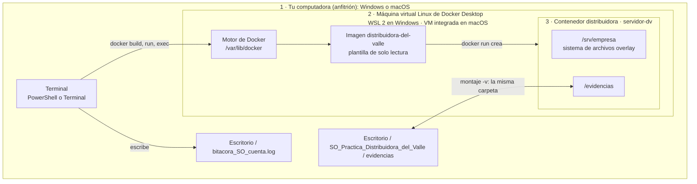
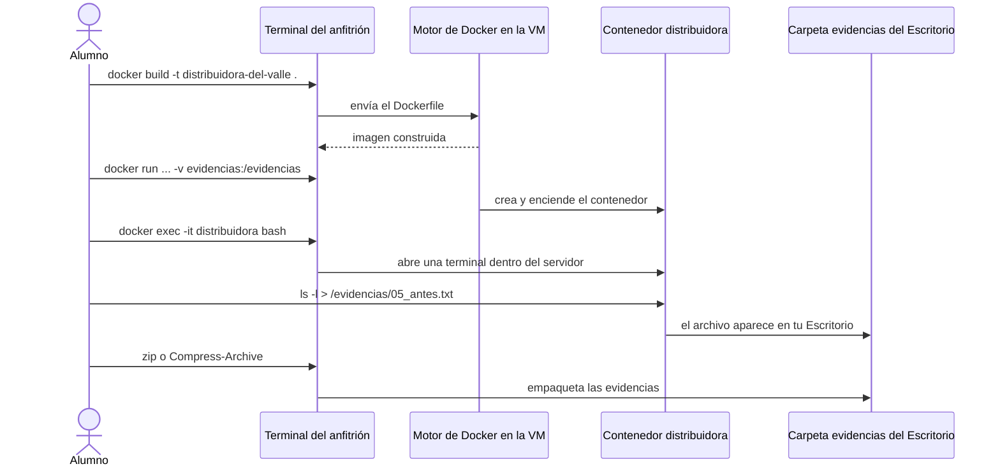
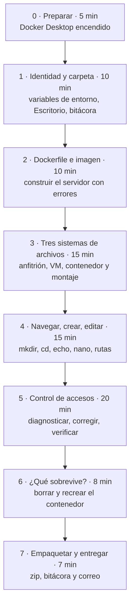
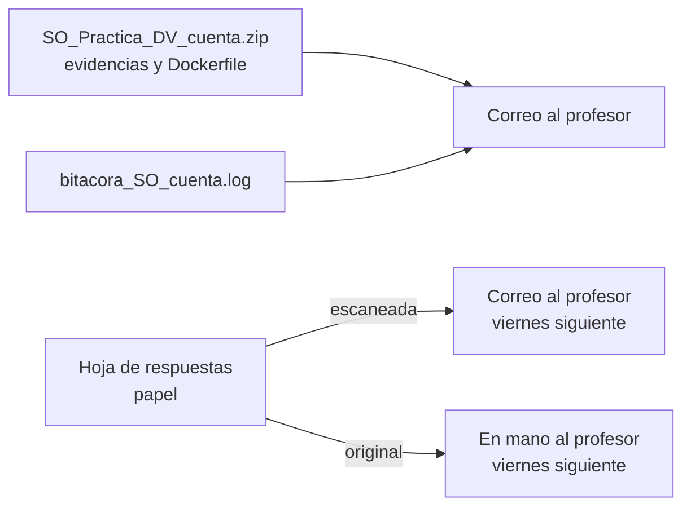

# Práctica · Sistemas de archivos y control de accesos con Docker

## El caso Distribuidora del Valle, de la teoría a la terminal

| | |
|---|---|
| **Materia** | Sistemas Operativos |
| **Programa** | Licenciatura en Informática Administrativa · 3er semestre · UAEMEX |
| **Duración** | 90 minutos |
| **Modalidad** | Individual, en tu propia computadora |
| **Entregables** | Correo con el `.zip` de evidencias y la bitácora `.log`, al terminar la clase · Hoja de respuestas escaneada por correo **y** en mano, el viernes siguiente a la práctica |

---

## 1. Objetivos

**Objetivo general.** Que administres, solo con la línea de comandos, un servidor Linux que corre en Docker, y que distingas en todo momento **en qué sistema de archivos estás trabajando** y **quién tiene acceso a qué**.

Al terminar podrás:

1. **Distinguir los sistemas de archivos que conviven** al usar Docker: el de tu sistema operativo (anfitrión), el de la máquina virtual de Docker y el del contenedor.
2. **Reconocer la nomenclatura de cada uno**: `C:\Users\...` en Windows, `/Users/...` en macOS, `/var/lib/docker` en la máquina virtual y `/srv/empresa` en el contenedor.
3. **Construir un servidor a partir de un Dockerfile** que reproduce la Distribuidora del Valle con sus errores de seguridad.
4. **Crear estructuras de carpetas, navegar, escribir y editar archivos** con comandos básicos de Linux.
5. **Diagnosticar y corregir permisos** con `ls -l`, `chmod`, `chown`, `su` y `sudo`, actuando siempre con el usuario adecuado.
6. **Dejar evidencia breve y verificable** de tu trabajo en una bitácora y un paquete `.zip`.

**¿Para qué le sirve esto a un administrador informático?** Hoy muchos sistemas de una organización corren en contenedores. Si no sabes dónde quedan los datos, puedes perderlos al borrar un contenedor. Si no sabes quién tiene acceso, puedes exponer la nómina o las contraseñas. Esta práctica entrena ambas cosas.

---

## 2. Antes de la clase (requisitos)

- [ ] **Docker Desktop instalado** y abierto **al menos una vez** antes de la clase, para que termine su configuración inicial.
  - Windows 10 (22H2) u 11: requiere WSL 2, que el instalador activa.
  - macOS: elige el instalador para tu procesador (Apple o Intel).
- [ ] **Internet** durante la sección 2: se descarga Ubuntu (unos 30 MB) y tres programas pequeños.
- [ ] Al menos **1 GB libre** en disco.
- [ ] Tu **número de cuenta** a la mano.
- [ ] Una **hoja** para tus respuestas y una pluma.

---

## 3. ¿Qué guía sigo?

| Tu sistema | Abre esta guía | Terminal que usarás |
|---|---|---|
| Windows 10 u 11 (en español o en inglés) | **[WINDOWS.md](WINDOWS.md)** | Windows PowerShell |
| macOS | **[MACOS.md](MACOS.md)** | Terminal (zsh) |
| Linux | **[MACOS.md](MACOS.md)**, con la nota del paso 1.2 | Terminal (bash) |

Ambas guías tienen **las mismas secciones, los mismos pasos dentro del contenedor y las mismas evidencias**. Solo cambian los comandos de tu sistema anfitrión.

---

## 4. El caso: Distribuidora del Valle

La empresa comparte un servidor Linux. Tú eres parte del equipo de administración.

| Grupo (departamento) | Usuarios |
|---|---|
| `contabilidad` | `ana` (contadora), `marta` (auxiliar contable) |
| `ventas` | `sofia` (jefa de ventas), `luis` (vendedor) |
| `practicantes` | `jorge` (practicante) |
| `sudo` | `admin` (administrador) |

Así está la carpeta compartida `/srv/empresa` cuando el Dockerfile construye el servidor. Tiene los **tres errores** que detectaste en el ejercicio en parejas:

```text
-rw-r--r-- 1 root  root         claves_wifi.txt     ← todos leen las claves
-rw-rw-rw- 1 luis  ventas       clientes.csv        ← cualquiera modifica la base de clientes
drwxr-x--- 2 ana   contabilidad contabilidad
-rw-r--r-- 1 sofia ventas       manual_ventas.pdf
-rw-r----- 1 ana   contabilidad nomina.xlsx
drw-r--r-- 2 jorge practicantes practicas           ← su dueño no puede entrar (falta x)
-rwxr-xr-x 1 root  root         respaldo.sh
drwxrwx--- 2 sofia ventas       ventas
```

---

## 5. Arquitectura: tres sistemas de archivos en una sola computadora



| Nivel | Dónde vive | Ejemplo de ruta | Qué debes recordar |
|---|---|---|---|
| **1 · Anfitrión** | Tu disco (NTFS en Windows, APFS en macOS) | `C:\Users\ana\Desktop\...` o `/Users/ana/Desktop/...` | Aquí están tu bitácora y tu zip. Sobrevive a todo. |
| **2 · Máquina virtual de Docker** | Un Linux que Docker Desktop enciende por ti | `/var/lib/docker` | Ahí se guardan imágenes y contenedores. Su kernel es el que usan todos los contenedores. |
| **3 · Contenedor** | Capas `overlay` dentro de la máquina virtual | `/srv/empresa` | Lo que cambies aquí **se pierde** al borrar el contenedor. |
| **Montaje** (puente entre 1 y 3) | Tu disco, visto desde el contenedor | `/evidencias` = `...\evidencias` | Es **la misma carpeta con dos nombres**. Lo que guardes aquí sobrevive. |

### Recorrido de un comando



---

## 6. Flujo de la práctica y tiempos



| Sección | Tiempo | Qué haces | Evidencia que se genera |
|---|---|---|---|
| 0 · Preparar | 5 min | Comprobar que Docker responde | — |
| 1 · Identidad y carpeta | 10 min | Variables de entorno, carpeta en el Escritorio, bitácora | `bitacora_SO_<cuenta>.log` |
| 2 · Dockerfile e imagen | 10 min | Escribir el Dockerfile, construir la imagen, crear el contenedor | `Dockerfile` |
| 3 · Sistemas de archivos | 15 min | Comparar anfitrión, VM y contenedor; probar el montaje | `03_contenedor.txt`, `03_desde_contenedor.txt`, `03_desde_anfitrion.txt` |
| 4 · Navegar y editar | 15 min | Estructura de carpetas como sofia, editar con nano, rutas | `04_estructura.txt` |
| 5 · Control de accesos | 20 min | Detectar, comprobar y corregir los tres errores | `05_antes.txt`, `05_despues.txt`, `05_verificacion.txt` |
| 6 · Persistencia | 8 min | Borrar y recrear el contenedor | `06_recreado.txt` |
| 7 · Entrega | 7 min | Cerrar la bitácora, crear el zip, enviar | `SO_Practica_DV_<cuenta>.zip` |

---

## 7. Reglas de trabajo

1. **Un comando a la vez.** Lee el comentario (`#`) que está arriba de cada comando antes de ejecutarlo. Entender el *porqué* es parte de la evaluación.
2. **Fíjate dónde estás.** Cada bloque indica si va en tu **terminal del anfitrión** o **dentro del contenedor**. El prompt te lo confirma: `PS C:\...>` o `usuario@Mac ~ %` en el anfitrión, y `root@servidor-dv:/srv/empresa#` en el contenedor.
3. **Dentro del contenedor, regresa siempre a root** (`exit`) antes de cambiar a otro usuario con `su`.
4. **Todo es idempotente.** Si te equivocas o no estás seguro, repite el paso: las carpetas existentes se reutilizan y los archivos se reemplazan. Para reiniciar el servidor con su configuración original, usa el paso 6.1.
5. **Si cierras la terminal**, ejecuta el *bloque de reanudación* que está al inicio de tu guía: las variables de entorno solo duran mientras la terminal está abierta.
6. **Los mensajes de error que la guía anuncia son parte del aprendizaje.** `Permission denied` y `Operation not permitted` demuestran que los permisos funcionan.

---

## 8. Evidencias y bitácora

Las salidas están **controladas para ser cortas**: cada evidencia ocupa de una a treinta líneas, la bitácora unas treinta y cinco, y el zip completo pesa menos de 10 KB.

| Archivo | Dónde | Contenido |
|---|---|---|
| `bitacora_SO_<cuenta>.log` | Escritorio | Tu nombre, número de cuenta, nombre del equipo (`hostname`), hora de inicio y fin, datos de la máquina virtual de Docker y un registro por sección. |
| `evidencias/03_contenedor.txt` | Proyecto | Tu identidad vista desde el contenedor, su kernel y sus sistemas de archivos. |
| `evidencias/03_desde_*.txt` | Proyecto | Prueba de que la carpeta montada funciona en ambos sentidos. |
| `evidencias/04_estructura.txt` | Proyecto | Árbol de `ventas` con permisos y el archivo que editaste. |
| `evidencias/05_antes.txt` y `05_despues.txt` | Proyecto | `ls -l` antes y después de corregir. |
| `evidencias/05_verificacion.txt` | Proyecto | Cinco pruebas de acceso con su resultado (0 = permitido). |
| `evidencias/06_recreado.txt` | Proyecto | Estado del servidor después de recrear el contenedor. |
| `SO_Practica_DV_<cuenta>.zip` | Escritorio | La carpeta `evidencias` y el `Dockerfile`. |

---

## 9. Hoja de respuestas

Cada sección termina con una **actividad**. Respóndelas a mano en una hoja que entregarás **el viernes siguiente a la práctica**, escaneada por correo y en mano (ver [Entrega](#10-entrega)).

**Instrucciones para la hoja:**

1. Usa una hoja blanca o de cuaderno. Escribe con pluma y letra legible.
2. En el encabezado anota: **nombre completo, número de cuenta, grupo, fecha** y el título *Práctica: Distribuidora del Valle en Docker*.
3. Anota también tu **sistema** (Windows o macOS) y el **nombre de tu equipo** tal como aparece en tu bitácora.
4. Numera las respuestas del **1 al 12**. Sé breve: el dato que se pide y una o dos líneas de explicación.
5. Responde **al terminar cada sección**, no al final: así usas tus propios resultados.
6. Es trabajo **individual**. Puedes consultar tus guías y apuntes.
7. **Entrégala el viernes siguiente a la práctica, de dos formas:** escaneada por correo y el original en mano al profesor.

**Las 12 preguntas** (también aparecen al final de cada sección de tu guía):

| # | Sección | Pregunta |
|---|---|---|
| 1 | 1 | ¿Qué ruta mostró tu Escritorio? ¿Por qué se la pedimos al sistema en lugar de escribirla a mano? ¿Qué problema evita? |
| 2 | 1 | ¿Qué es un comando **idempotente**? Escribe uno de la sección 1 que lo sea. |
| 3 | 2 | ¿Cuál es la diferencia entre la **imagen** `distribuidora-del-valle` y el **contenedor** `distribuidora`? |
| 4 | 2 | ¿Para qué le sirve a un administrador describir un servidor en un Dockerfile en lugar de configurarlo a mano? |
| 5 | 3 | Escribe la ruta de tu carpeta de evidencias vista desde tu sistema y desde el contenedor. ¿Por qué es la misma carpeta con dos nombres? |
| 6 | 3 | ¿Qué kernel mostró `uname -r` en el contenedor? ¿Por qué coincide con el de la VM de Docker y no con tu sistema? |
| 7 | 4 | Desde `/srv/empresa/ventas/reportes/2026/octubre`, escribe la ruta relativa y la absoluta para llegar a `/srv/empresa/ventas`. |
| 8 | 4 | ¿Por qué sofia pudo crear carpetas dentro de `ventas` y jorge no? Usa la categoría (u, g, o) y el permiso. |
| 9 | 5 | Para cada uno de los tres riesgos, ¿qué comando usaste y quién lo ejecutó? ¿Por qué esa persona? |
| 10 | 5 | ¿Por qué admin necesitó `sudo` para `claves_wifi.txt` y luis no lo necesitó para `clientes.csv`? |
| 11 | 6 | Al borrar y recrear el contenedor, ¿qué se perdió y qué se conservó? ¿Por qué? |
| 12 | 6 | En un servidor real con contenedores, ¿dónde guardarías los datos importantes y por qué? |

---

## 10. Entrega



**Al terminar la práctica, antes de salir del salón:**

> **Nota:** la **hoja de respuestas** no se entrega hoy. Se entrega **el viernes siguiente a la práctica**, escaneada por correo **y** en mano (ver más abajo). Hoy solo envías el zip y la bitácora.

1. **Envía un correo** a la dirección que indique el profesor, con:
   - **Asunto:** `[SO] Práctica Distribuidora - <número de cuenta> - <nombre completo>`
   - **Dos archivos adjuntos**, ambos en tu Escritorio:
     1. `SO_Practica_DV_<cuenta>.zip`
     2. `bitacora_SO_<cuenta>.log`
   - **Cuerpo del mensaje:**

     ```text
     Nombre: <nombre completo>
     Número de cuenta: <número>
     Grupo: <grupo>
     Sistema usado: Windows / macOS / Linux
     Adjunto el zip de evidencias y la bitácora de la práctica Distribuidora del Valle.
     ```

**Antes de enviar, revisa:**

- [ ] La bitácora tiene tu nombre, número de cuenta y el nombre de tu equipo.
- [ ] La bitácora llega hasta la sección 7 y tiene hora de fin.
- [ ] El zip contiene la carpeta `evidencias`, con 8 archivos, y el `Dockerfile`.
- [ ] Adjuntaste **los dos** archivos: el zip **y** la bitácora.

**El viernes siguiente a la práctica, entrega tu hoja de respuestas de dos formas:**

1. **Escaneada, por correo**, a la misma dirección:
   - **Asunto:** `[SO] Hoja Práctica Distribuidora - <número de cuenta> - <nombre completo>`
   - **Adjunto:** la hoja en **un solo PDF** (puedes usar la función de escanear documentos de la cámara o de una app de tu celular). Revisa que se lean tu nombre, tu número de cuenta y las 12 respuestas.
2. **En mano**: entrega la hoja original al profesor en clase.

---

## 11. Evaluación

| Criterio | Peso | Qué se revisa |
|---|---|---|
| Ejecución completa | 40 % | El zip contiene las 8 evidencias, el Dockerfile sin cambios y resultados coherentes (ver la tabla siguiente). |
| Bitácora | 20 % | Identidad, equipo, datos de la VM de Docker y registro de las secciones 1 a 7. |
| Hoja de respuestas | 40 % | 12 respuestas, correctas y justificadas con lo que observaste en tu propia ejecución. |

### Para el profesor: cómo verificar una entrega en un minuto

| Revisa | Resultado esperado |
|---|---|
| `03_contenedor.txt` | La cuenta y el nombre coinciden con la bitácora: llegaron por variables de entorno. |
| Bitácora, línea *Kernel de la VM* | Igual al kernel de `03_contenedor.txt`. Termina en `microsoft-standard-WSL2` en Windows o en `linuxkit` en macOS. |
| `04_estructura.txt` | Árbol `reportes/2026/octubre` con dueño `sofia` y la línea `Revisado por: <nombre del alumno>`. |
| `05_antes.txt` y `05_despues.txt` | Antes: `666`, `644` y `drw-r--r--` en los tres archivos con error. Después: `-rw-rw----`, `-rw-------` y `drwx------ sofia ventas`. |
| `05_verificacion.txt` | Pruebas 1 a 4 con resultado `1` (negado) y prueba 5 con `0` (permitido). |
| `06_recreado.txt` | Los permisos originales de nuevo, la línea `No such file or directory` para `03_solo_contenedor.txt` y la lista de evidencias. |

---

## 12. Problemas generales

| Situación | Qué hacer |
|---|---|
| No tengo Docker Desktop instalado | Instálalo siguiendo las guías oficiales (anexo, fuentes 1 y 2). Mientras tanto, trabaja en pareja con un compañero, pero **entrega tu propia hoja**. |
| La descarga de la sección 2 es muy lenta | Espera: solo ocurre la primera vez. Mientras termina, responde las preguntas 1 y 2. |
| Me perdí y no sé en qué paso voy | Revisa tu bitácora: la última sección registrada es la última que completaste. |
| Quiero empezar el servidor de cero | Ejecuta el paso 6.1 de tu guía: recrea el contenedor con la configuración original sin borrar tus evidencias. |

Los problemas propios de cada sistema están al final de [WINDOWS.md](WINDOWS.md#problemas-frecuentes-en-windows-10-u-11) y [MACOS.md](MACOS.md#problemas-frecuentes-en-macos).

---

## Anexo: fuentes y referencias

**Docker**

1. Docker Inc. *Install Docker Desktop on Windows.* https://docs.docker.com/desktop/setup/install/windows-install/
2. Docker Inc. *Install Docker Desktop on Mac.* https://docs.docker.com/desktop/setup/install/mac-install/
3. Docker Inc. *What is Docker?* Imágenes, contenedores y arquitectura. https://docs.docker.com/get-started/docker-overview/
4. Docker Inc. *Dockerfile reference.* https://docs.docker.com/reference/dockerfile/
5. Docker Inc. *Storage.* La capa de escritura del contenedor no persiste al destruirlo. https://docs.docker.com/engine/storage/
6. Docker Inc. *Bind mounts.* https://docs.docker.com/engine/storage/bind-mounts/
7. Docker Inc. *docker system info*, incluida la opción `--format`. https://docs.docker.com/reference/cli/docker/system/info/
8. Docker Inc. *Docker Desktop WSL 2 backend on Windows.* https://docs.docker.com/desktop/features/wsl/

**Sistemas anfitriones**

9. Microsoft. *What is the Windows Subsystem for Linux?* WSL 2 ejecuta un kernel Linux real en una máquina virtual ligera. https://learn.microsoft.com/en-us/windows/wsl/about
10. Microsoft. *Environment.SpecialFolder Enum*, carpeta del Escritorio. https://learn.microsoft.com/en-us/dotnet/api/system.environment.specialfolder
11. Microsoft. *about_Environment_Variables* (PowerShell). https://learn.microsoft.com/en-us/powershell/module/microsoft.powershell.core/about/about_environment_variables
12. Microsoft. *Compress-Archive* (PowerShell). https://learn.microsoft.com/en-us/powershell/module/microsoft.powershell.archive/compress-archive
13. Apple. *Terminal User Guide for Mac.* https://support.apple.com/guide/terminal/welcome/mac
14. freedesktop.org. *xdg-user-dirs*, carpetas de usuario localizadas en Linux. https://www.freedesktop.org/wiki/Software/xdg-user-dirs/

**Linux: sistemas de archivos y control de accesos**

15. The Linux Kernel documentation. *Overlay Filesystem.* https://docs.kernel.org/filesystems/overlayfs.html
16. Linux Foundation. *Filesystem Hierarchy Standard 3.0.* https://refspecs.linuxfoundation.org/FHS_3.0/fhs/index.html
17. Linux man-pages project. *chmod(1).* https://man7.org/linux/man-pages/man1/chmod.1.html
18. Linux man-pages project. *chown(1).* https://man7.org/linux/man-pages/man1/chown.1.html
19. Linux man-pages project. *su(1).* https://man7.org/linux/man-pages/man1/su.1.html
20. Linux man-pages project. *useradd(8).* https://man7.org/linux/man-pages/man8/useradd.8.html
21. Linux man-pages project. *path_resolution(7)*: rutas y revisión de permisos. https://man7.org/linux/man-pages/man7/path_resolution.7.html
22. Free Software Foundation. *GNU Coreutils: File permissions.* https://www.gnu.org/software/coreutils/manual/html_node/File-permissions.html
23. Miller, T. C. et al. *Sudo Manual.* https://www.sudo.ws/docs/man/sudo.man/
24. Arpaci-Dusseau, R. H. y Arpaci-Dusseau, A. C. (2018). *Operating Systems: Three Easy Pieces*, cap. «Files and Directories». https://pages.cs.wisc.edu/~remzi/OSTEP/file-intro.pdf
