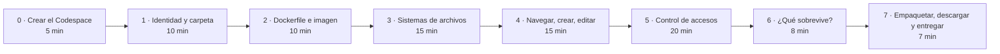
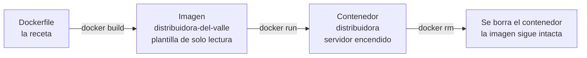
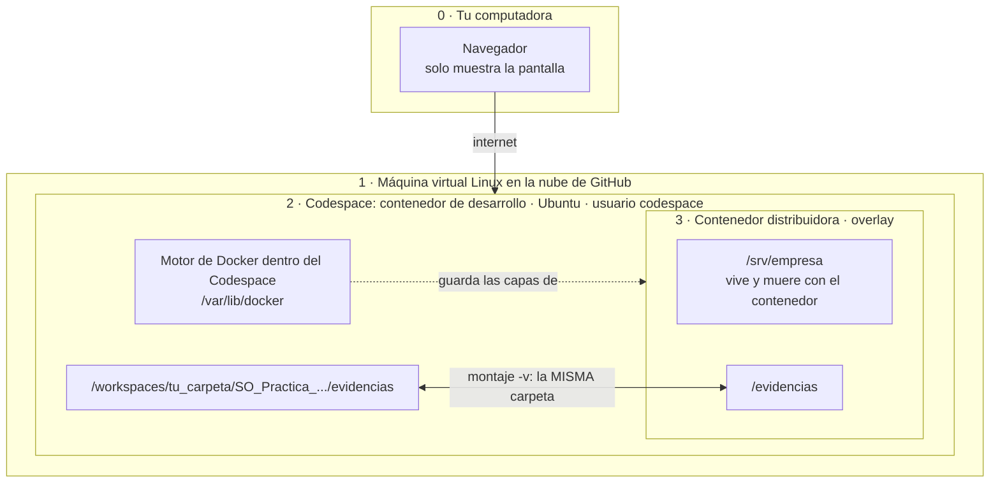
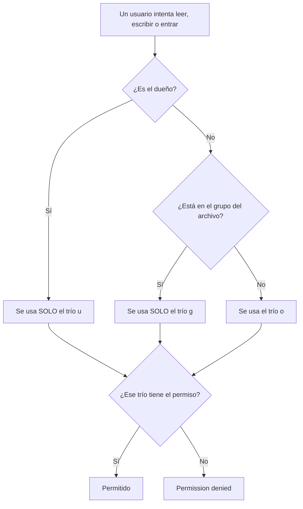
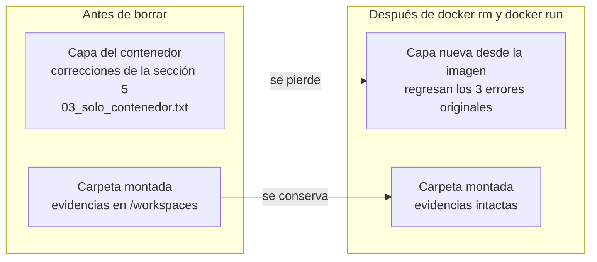
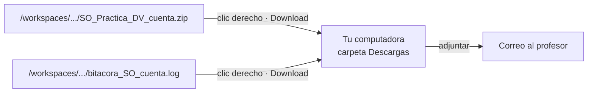

# Práctica · Distribuidora del Valle en Docker · Guía para GitHub Codespaces

*Sistemas Operativos · Licenciatura en Informática Administrativa · UAEMEX · 90 minutos · Trabajo individual*

> Sigue esta guía si vas a trabajar **en el navegador, con GitHub Codespaces**, sin instalar nada en tu computadora.
> ¿Prefieres tu propia computadora con Docker Desktop? Usa [WINDOWS.md](WINDOWS.md) o [MACOS.md](MACOS.md).
> El panorama general, la hoja de respuestas y la forma de entrega están en el [README_CODESPACES](README_CODESPACES.md).

## Cómo leer esta guía

- Cada paso empieza con una explicación de **qué** vas a hacer y **para qué** le sirve a un administrador.
- En los bloques de código, cada comando tiene arriba un comentario (la línea que empieza con `#`). **Lee el comentario y ejecuta los comandos uno por uno.** Copia solo las líneas que no empiezan con `#`; si copias un comentario, no pasa nada.
- Arriba de cada bloque se indica **dónde** se ejecuta:
  - **Terminal del Codespace**: el entorno Linux en la nube que abres en el navegador. El prompt se ve como `@tu_usuario ➜ /workspaces/... $`.
  - **Contenedor**: el servidor Linux de la empresa, que corre **dentro** de tu Codespace. El prompt se ve como `root@servidor-dv:/srv/empresa#`.
- La práctica es **idempotente**: puedes repetir cualquier paso sin romper nada. Si una carpeta ya existe, se usa; si un archivo ya existe, se reemplaza.
- Al final de cada sección hay una **actividad**: responde sus preguntas a mano en tu hoja (ver [Hoja de respuestas](README_CODESPACES.md#9-hoja-de-respuestas)).

## Si se detuvo el Codespace o abriste otra terminal (bloque de reanudación)

Las variables de entorno solo duran mientras la terminal está abierta, y el Codespace se detiene solo tras 30 minutos sin actividad. Si eso pasa:

1. Abre tu Codespace desde [github.com/codespaces](https://github.com/codespaces).
2. Abre una terminal **nueva**: menú ☰ → *Terminal* → *New Terminal*.
3. Ejecuta este bloque **con tus datos** antes de continuar donde te quedaste:

**Dónde:** la terminal de tu Codespace (`@tu_usuario ➜ /workspaces/... $`)

```bash
# Guarda tu carpeta de trabajo (abre una terminal NUEVA: siempre empieza ahí)
export TRABAJO="$PWD"

# Tu número de cuenta (cámbialo por el tuyo)
export ALUMNO_CUENTA="1234567"

# Tu nombre completo, entre comillas
export ALUMNO_NOMBRE="Nombre Apellido Apellido"

# Carpeta del proyecto dentro de tu carpeta de trabajo
export PRACTICA="$TRABAJO/SO_Practica_Distribuidora_del_Valle"

# Subcarpeta de evidencias
export EVIDENCIAS="$PRACTICA/evidencias"

# Archivo de bitácora en tu carpeta de trabajo
export BITACORA="$TRABAJO/bitacora_SO_${ALUMNO_CUENTA}.log"

# Entra a la carpeta del proyecto
cd "$TRABAJO/SO_Practica_Distribuidora_del_Valle"

# Pregunta si el contenedor ya existe (guarda su id o nada)
EXISTE=$(docker ps -a --quiet --filter 'name=^distribuidora$')

# Solo si existe (-n: texto NO vacío), enciéndelo
if [ -n "$EXISTE" ]; then
  docker start distribuidora
fi
```

## Mapa de la práctica



---

## Sección 0 · Crear tu Codespace (5 min)

**Por qué:** un **Codespace** es una computadora Linux en la nube de GitHub que se maneja desde el navegador. No tienes que instalar nada, y ya trae Docker. Para un administrador es una forma rápida de tener un entorno limpio, igual para todos y desechable.

1. Inicia sesión en [github.com](https://github.com). Si no tienes cuenta, créala con tu correo.
2. Entra a [github.com/codespaces](https://github.com/codespaces).
3. En *Explore quick start templates*, haz clic en **See all**.
4. Busca la plantilla **Blank** y haz clic en **Use this template**.
5. Espera uno o dos minutos: se abrirá un editor (Visual Studio Code) **dentro del navegador**.
6. Abre una terminal: menú ☰ → *Terminal* → *New Terminal* (o **Ctrl + `**).

Comprueba que Docker responde:

**Dónde:** la terminal de tu Codespace (`@tu_usuario ➜ /workspaces/... $`)

```bash
# Pregunta al motor de Docker su versión; si responde, Docker está listo
docker version --format '{{.Server.Version}}'
```

Si aparece un número de versión, todo está listo. Si aparece `Cannot connect to the Docker daemon`, el motor todavía está arrancando: espera 30 segundos y repite.

> **Cuota gratuita.** Las cuentas personales de GitHub incluyen cada mes un tiempo de uso gratuito de Codespaces, suficiente para muchas prácticas como esta. Al terminar, **detén** tu Codespace (paso 7.5) para no gastarlo.

---

## Sección 1 · Tu identidad, tu carpeta de trabajo y la carpeta del proyecto (10 min)

**Por qué:** en una organización, cada acción sobre un servidor debe poder rastrearse: **quién** la hizo, **en qué equipo** y **cuándo**. Por eso lo primero es registrar tu identidad en **variables de entorno**, es decir, datos con nombre que la terminal recuerda y que los programas pueden leer. Codespaces ya crea algunas por ti, como tu usuario de GitHub y el nombre de tu Codespace. Las dos aparecerán en tu bitácora.

### Paso 1.1 · Registrar tu identidad

Escribe **tu** número de cuenta y **tu** nombre en lugar de los ejemplos:

**Dónde:** la terminal de tu Codespace (`@tu_usuario ➜ /workspaces/... $`)

```bash
# Guarda tu número de cuenta en una variable de entorno (cámbialo por el tuyo)
export ALUMNO_CUENTA="1234567"

# Guarda tu nombre completo, entre comillas
export ALUMNO_NOMBRE="Nombre Apellido Apellido"

# Muestra el número de cuenta para comprobarlo
echo "$ALUMNO_CUENTA"

# Muestra el nombre para comprobarlo
echo "$ALUMNO_NOMBRE"
```

### Paso 1.2 · Ubicar tu carpeta de trabajo

En Codespaces **no hay Escritorio**: todo vive en una carpeta de trabajo dentro de `/workspaces`, que es la que ves en el **Explorador**, el panel de la izquierda. Esa carpeta se conserva aunque el Codespace se detenga. Una terminal nueva **siempre empieza ahí**, así que guardamos su ruta con `$PWD`, la variable que contiene la carpeta actual, sin escribirla a mano.

> Ejecuta este bloque en una terminal **recién abierta**, antes de usar cualquier `cd`.

**Dónde:** la terminal de tu Codespace (`@tu_usuario ➜ /workspaces/... $`)

```bash
# Guarda tu carpeta de trabajo: una terminal nueva siempre empieza ahí
export TRABAJO="$PWD"

# Define la carpeta del proyecto dentro de tu carpeta de trabajo
export PRACTICA="$TRABAJO/SO_Practica_Distribuidora_del_Valle"

# Define la subcarpeta donde quedarán las evidencias
export EVIDENCIAS="$PRACTICA/evidencias"

# Define la bitácora: en tu carpeta de trabajo y con tu número de cuenta en el nombre
export BITACORA="$TRABAJO/bitacora_SO_${ALUMNO_CUENTA}.log"

# Muestra tu carpeta de trabajo (debe empezar con /workspaces/)
echo "$TRABAJO"

# Muestra la ruta de la carpeta del proyecto
echo "$PRACTICA"

# Muestra la ruta de la bitácora
echo "$BITACORA"

# Muestra tu usuario de GitHub (variable creada por Codespaces)
echo "$GITHUB_USER"

# Muestra el nombre de tu Codespace (variable creada por Codespaces)
echo "$CODESPACE_NAME"
```

### Paso 1.3 · Crear la carpeta del proyecto

Con `mkdir -p`, si la carpeta no existe se crea y si ya existe se usa sin marcar error. Además crea las carpetas intermedias que falten. Eso hace al paso **idempotente**. La carpeta se llamará `SO_Practica_Distribuidora_del_Valle`, sin espacios ni acentos.

**Dónde:** la terminal de tu Codespace (`@tu_usuario ➜ /workspaces/... $`)

```bash
# Crea la carpeta del proyecto (si ya existe, no marca error)
mkdir -p "$PRACTICA"

# Crea la subcarpeta de evidencias del mismo modo
mkdir -p "$EVIDENCIAS"
```

### Paso 1.4 · Entrar a la carpeta del proyecto

Desde ahora trabajarás **dentro** de esta carpeta. `cd` cambia tu directorio de trabajo, el mismo concepto de la sesión 1:

**Dónde:** la terminal de tu Codespace (`@tu_usuario ➜ /workspaces/... $`)

```bash
# Entra a la carpeta del proyecto
cd "$TRABAJO/SO_Practica_Distribuidora_del_Valle"

# Muestra la carpeta en la que estás ahora
pwd
```

### Paso 1.5 · Crear la bitácora en tu carpeta de trabajo

La **bitácora** es un archivo de texto corto con tu identidad, tu dispositivo y los datos clave de cada sección. Se crea en tu carpeta de trabajo, **fuera** de la carpeta del proyecto, para que la encuentres fácilmente al descargarla. En Codespaces, tu «dispositivo» es el propio Codespace: lo identifica la variable `CODESPACE_NAME`.

**Dónde:** la terminal de tu Codespace (`@tu_usuario ➜ /workspaces/... $`)

```bash
# Guarda la fecha y hora de inicio
INICIO=$(date "+%Y-%m-%d %H:%M")

# Crea la bitácora con su encabezado (> crea o reinicia el archivo)
echo "=== Bitácora · Práctica Distribuidora del Valle ===" > "$BITACORA"

# Agrega tu nombre (>> agrega al final)
echo "Alumno: $ALUMNO_NOMBRE" >> "$BITACORA"

# Agrega tu número de cuenta
echo "Número de cuenta: $ALUMNO_CUENTA" >> "$BITACORA"

# Agrega tu usuario de GitHub
echo "Usuario de GitHub: $GITHUB_USER" >> "$BITACORA"

# Agrega el identificador del dispositivo: el nombre de tu Codespace
echo "Codespace (dispositivo): $CODESPACE_NAME" >> "$BITACORA"

# Agrega el entorno de trabajo
echo "Entorno: GitHub Codespaces" >> "$BITACORA"

# Agrega la hora de inicio
echo "Inicio: $INICIO" >> "$BITACORA"

# Agrega la ruta del proyecto
echo "Carpeta del proyecto: $PRACTICA" >> "$BITACORA"

# Muestra la bitácora completa
cat "$BITACORA"
```

Debes ver algo así, y el archivo aparecerá en el Explorador:

```text
=== Bitácora · Práctica Distribuidora del Valle ===
Alumno: Ana López Martínez
Número de cuenta: 1234567
Usuario de GitHub: analopez-uaemex
Codespace (dispositivo): analopez-uaemex-super-duper-space-x7q9
Entorno: GitHub Codespaces
Inicio: 2026-10-21 10:05
Carpeta del proyecto: /workspaces/codespaces-blank/SO_Practica_Distribuidora_del_Valle
```

> Si repites este paso, la bitácora se reinicia desde cero, y es lo correcto. Si la repites ya avanzada la práctica, vuelve a ejecutar los pasos de bitácora de las secciones siguientes.

### Actividad 1 · Responde en tu hoja

1. ¿Qué ruta mostró tu carpeta de trabajo en el paso 1.2? ¿Por qué la tomamos de `$PWD` en lugar de escribirla a mano? ¿Qué problema evita?
2. Explica con tus palabras qué es un comando **idempotente** y escribe un comando de esta sección que lo sea.

---

## Sección 2 · Construir el servidor con un Dockerfile (10 min)

**Por qué:** configurar un servidor a mano es lento y difícil de repetir igual. Un **Dockerfile** es la *receta escrita* del servidor: qué sistema usa, qué usuarios y grupos tiene, qué archivos y qué permisos. Con esa receta, Docker construye una **imagen**, una plantilla de solo lectura, y a partir de la imagen enciende **contenedores**, que son servidores en funcionamiento.

Este Dockerfile reproduce la **Distribuidora del Valle tal como la encontraste en el ejercicio en parejas**, con sus tres errores de seguridad incluidos. En la sección 5 los vas a corregir.



### Paso 2.1 · Escribir el Dockerfile

El comando `cat > Dockerfile <<'EOF'` escribe **tal cual** todo lo que sigue, hasta la línea `EOF`, en el archivo `Dockerfile` (sin extensión) dentro de tu proyecto. Si el archivo ya existía, lo reemplaza. Copia el bloque **completo**, desde `cat` hasta `EOF`, y pégalo de una sola vez. Lee los comentarios del Dockerfile: describen cada parte del servidor. Al terminar, el archivo aparecerá en el Explorador y podrás abrirlo con un clic.

**Dónde:** la terminal de tu Codespace (`@tu_usuario ➜ /workspaces/... $`)

```bash
# Escribe todo lo que sigue, hasta la línea EOF, en el archivo Dockerfile del proyecto
cat > "$PRACTICA/Dockerfile" <<'EOF'
# Practica: Distribuidora del Valle - Sistemas Operativos - UAEMEX
# Servidor Linux con la configuracion INICIAL (incluye errores que debes corregir)
FROM ubuntu:24.04

# Herramientas: sudo (privilegios), tree (ver arbol de carpetas), nano (editor de texto)
RUN apt-get update && apt-get install -y --no-install-recommends sudo tree nano && rm -rf /var/lib/apt/lists/*

# Quita el usuario de ejemplo que trae Ubuntu (si no existe, no pasa nada)
RUN userdel -r ubuntu || true

# Grupos: los departamentos de la empresa
RUN groupadd contabilidad
RUN groupadd ventas
RUN groupadd practicantes

# Usuarios: -m crea su carpeta personal, -s le da terminal bash, -G lo agrega a su departamento
RUN useradd -m -s /bin/bash -G contabilidad ana
RUN useradd -m -s /bin/bash -G contabilidad marta
RUN useradd -m -s /bin/bash -G ventas sofia
RUN useradd -m -s /bin/bash -G ventas luis
RUN useradd -m -s /bin/bash -G practicantes jorge

# Administrador: pertenece al grupo sudo y no necesita contrasena (solo para esta practica)
RUN useradd -m -s /bin/bash -G sudo admin
RUN echo "admin ALL=(ALL) NOPASSWD:ALL" > /etc/sudoers.d/admin
RUN chmod 440 /etc/sudoers.d/admin
RUN touch /home/admin/.sudo_as_admin_successful

# Carpeta compartida de la empresa
RUN mkdir -p /srv/empresa/contabilidad /srv/empresa/ventas /srv/empresa/practicas
WORKDIR /srv/empresa

# Archivos de la empresa (contenido ficticio)
RUN echo "SSID: DistribuidoraValle  Clave: Valle#2026" > claves_wifi.txt
RUN printf "cliente,telefono\nFerreteria Lopez,722-555-0101\n" > clientes.csv
RUN echo "Manual de ventas: descuentos y devoluciones" > manual_ventas.pdf
RUN printf "empleado,sueldo\nana,28000\nmarta,19000\nsofia,31000\nluis,17000\njorge,6000\n" > nomina.xlsx
RUN printf "#!/bin/bash\necho Respaldando /srv/empresa\n" > respaldo.sh
RUN echo "Cierre contable de octubre" > contabilidad/cierre_octubre.txt

# Duenos y grupos de cada elemento
RUN chown luis:ventas clientes.csv
RUN chown ana:contabilidad nomina.xlsx contabilidad contabilidad/cierre_octubre.txt
RUN chown sofia:ventas manual_ventas.pdf ventas
RUN chown jorge:practicantes practicas

# Permisos INICIALES (tres de ellos son errores de seguridad)
RUN chmod 644 claves_wifi.txt
RUN chmod 666 clientes.csv
RUN chmod 750 contabilidad
RUN chmod 640 contabilidad/cierre_octubre.txt
RUN chmod 644 manual_ventas.pdf
RUN chmod 640 nomina.xlsx
RUN chmod 644 practicas
RUN chmod 755 respaldo.sh
RUN chmod 770 ventas

# Punto de montaje donde aparecera tu carpeta de evidencias
RUN mkdir -p /evidencias

CMD ["bash"]
EOF

# Muestra el contenido para revisarlo
cat "$PRACTICA/Dockerfile"
```

### Paso 2.2 · Construir la imagen

La primera vez tarda menos de un minuto porque descarga Ubuntu e instala `sudo`, `tree` y `nano`. Si lo repites, Docker reutiliza lo ya construido (*caché*): también es idempotente.

**Dónde:** la terminal de tu Codespace (`@tu_usuario ➜ /workspaces/... $`)

```bash
# Asegúrate de estar en la carpeta del proyecto
cd "$TRABAJO/SO_Practica_Distribuidora_del_Valle"

# Construye la imagen a partir del Dockerfile de esta carpeta (el punto final significa "aquí")
docker build -t distribuidora-del-valle .

# Lista la imagen construida
docker image ls distribuidora-del-valle
```

### Paso 2.3 · Crear el contenedor (solo si no existe) y encenderlo

`docker run` crea el contenedor. Sus opciones, en orden:

| Opción | Para qué sirve |
|---|---|
| `-dit` | Lo deja encendido en segundo plano (`-d`) y con una terminal disponible (`-it`). |
| `--name distribuidora` | Le da un nombre fácil de usar en vez de un número. |
| `--hostname servidor-dv` | Es el nombre del servidor que verás en el prompt. |
| `-e ALUMNO_CUENTA -e ALUMNO_NOMBRE` | Copia tus variables de entorno **dentro** del contenedor. |
| `-v ...:/evidencias` | **Monta** tu carpeta de evidencias del Codespace dentro del servidor, en `/evidencias`. |

Como `docker run` falla si el contenedor ya existe, primero preguntamos si existe y solo lo creamos cuando no. Así el bloque es idempotente:

**Dónde:** la terminal de tu Codespace (`@tu_usuario ➜ /workspaces/... $`)

```bash
# Pregunta a Docker si ya existe un contenedor llamado distribuidora (guarda su id o nada)
EXISTE=$(docker ps -a --quiet --filter 'name=^distribuidora$')

# Solo si NO existe (-z: texto vacío), créalo (lee la explicación de cada opción arriba)
if [ -z "$EXISTE" ]; then
  docker run -dit --name distribuidora --hostname servidor-dv -e ALUMNO_CUENTA -e ALUMNO_NOMBRE -v "$EVIDENCIAS:/evidencias" distribuidora-del-valle
fi

# Enciende el contenedor (si ya estaba encendido, no pasa nada)
docker start distribuidora

# Muestra el contenedor y su estado
docker ps --filter 'name=^distribuidora$'
```

### Paso 2.4 · Registrar en la bitácora

**Dónde:** la terminal de tu Codespace (`@tu_usuario ➜ /workspaces/... $`)

```bash
# Guarda la fecha en que se construyó la imagen
IMAGEN=$(docker image inspect distribuidora-del-valle --format '{{.Created}}')

# Guarda el estado del contenedor
ESTADO=$(docker inspect distribuidora --format '{{.State.Status}}')

# Agrega el título de la sección
echo "--- Sección 2: servidor ---" >> "$BITACORA"

# Agrega la fecha de la imagen
echo "Imagen distribuidora-del-valle creada: $IMAGEN" >> "$BITACORA"

# Agrega el estado del contenedor
echo "Contenedor distribuidora: $ESTADO" >> "$BITACORA"
```

### Actividad 2 · Responde en tu hoja

3. ¿Cuál es la diferencia entre la **imagen** `distribuidora-del-valle` y el **contenedor** `distribuidora`?
4. ¿Para qué le sirve a un administrador describir un servidor en un Dockerfile en lugar de configurarlo a mano cada vez?

---

## Sección 3 · Sistemas de archivos, uno dentro de otro (15 min)

**Por qué:** en Codespaces tu computadora solo muestra el navegador: todo ocurre en la nube, en **capas una dentro de otra**, y cada capa tiene su propio sistema de archivos. Un administrador debe saber **en cuál está trabajando**, porque de eso depende dónde quedan los datos y si sobreviven.



| Nivel | Ejemplo de ruta | Qué debes recordar |
|---|---|---|
| 0 · Tu computadora | (ninguna) | Solo ves la pantalla. Nada de la práctica está aquí hasta que **descargas** tu entrega (paso 7.3). |
| 1 · Máquina virtual en la nube | (no la ves) | GitHub crea una máquina virtual para cada Codespace. Su **kernel** lo comparten todas las capas de abajo. |
| 2 · Codespace | `/workspaces/tu_carpeta/...` | Un contenedor Linux con tu usuario `codespace`. `/workspaces` se conserva al detener el Codespace, pero **se borra si borras el Codespace**. |
| Motor de Docker | `/var/lib/docker` | Corre **dentro** del Codespace (modo *docker-in-docker*). Ahí guarda imágenes y contenedores. |
| 3 · Contenedor | `/srv/empresa`, `/evidencias` | Linux: un solo árbol desde `/`, que distingue mayúsculas. Lo que cambies en `/srv/empresa` se pierde al borrar el contenedor. |

### Paso 3.1 · El Codespace

**Dónde:** la terminal de tu Codespace (`@tu_usuario ➜ /workspaces/... $`)

```bash
# Muestra con qué usuario trabajas en el Codespace
whoami

# Muestra la ruta de tu carpeta de proyecto
pwd

# Lista su contenido con detalle
ls -l

# Muestra el sistema operativo del Codespace (busca la línea PRETTY_NAME)
grep PRETTY_NAME /etc/os-release

# Muestra la versión del kernel que usa el Codespace
uname -r

# Guarda el kernel del Codespace en una variable
CS_KERNEL=$(uname -r)

# Agrega a la bitácora el título de la sección
echo "--- Sección 3: sistemas de archivos ---" >> "$BITACORA"

# Agrega el kernel del Codespace
echo "Kernel del Codespace: $CS_KERNEL" >> "$BITACORA"
```

**Qué observar:** eres el usuario `codespace`, en un sistema Ubuntu. Anota el kernel: lo vas a comparar en los pasos siguientes.

### Paso 3.2 · El motor de Docker

En Codespaces, Docker corre **dentro del propio Codespace**: es un contenedor que, a su vez, ejecuta contenedores (*docker-in-docker*). Por eso el sistema que reporta es el Ubuntu del Codespace y no «Docker Desktop». Pregúntale:

**Dónde:** la terminal de tu Codespace (`@tu_usuario ➜ /workspaces/... $`)

```bash
# Pregunta qué sistema ejecuta el motor de Docker
VM_SISTEMA=$(docker info --format '{{.OperatingSystem}}')

# Pregunta la versión del kernel que ve el motor de Docker
VM_KERNEL=$(docker info --format '{{.KernelVersion}}')

# Pregunta dónde guarda Docker imágenes y contenedores
VM_RAIZ=$(docker info --format '{{.DockerRootDir}}')

# Pregunta cómo registró Docker tu carpeta de evidencias
MONTAJE=$(docker inspect distribuidora --format '{{range .Mounts}}{{.Source}}{{end}}')

# Muestra el sistema que ejecuta el motor
echo "$VM_SISTEMA"

# Muestra el kernel que ve el motor
echo "$VM_KERNEL"

# Muestra la carpeta raíz de Docker
echo "$VM_RAIZ"

# Muestra el origen de tu carpeta montada
echo "$MONTAJE"

# Agrega el sistema del motor a la bitácora
echo "Motor de Docker: $VM_SISTEMA" >> "$BITACORA"

# Agrega el kernel que ve el motor
echo "Kernel visto por Docker: $VM_KERNEL" >> "$BITACORA"

# Agrega la carpeta raíz de Docker
echo "Raíz de Docker: $VM_RAIZ" >> "$BITACORA"

# Agrega el origen del montaje
echo "Origen del montaje /evidencias: $MONTAJE" >> "$BITACORA"
```

Verás el nombre de Ubuntu, **el mismo kernel del paso 3.1**, la ruta `/var/lib/docker` y la ruta de tu carpeta de evidencias en `/workspaces/...`.

### Paso 3.3 · Dentro del contenedor

Entra al servidor de la empresa. El prompt cambiará a `root@servidor-dv:/srv/empresa#`: ahora estás en el contenedor de la práctica.

**Dónde:** la terminal de tu Codespace (`@tu_usuario ➜ /workspaces/... $`)

```bash
# Abre una terminal DENTRO del contenedor (para salir, escribe exit)
docker exec -it distribuidora bash
```

**Dónde:** dentro del contenedor (`root@servidor-dv`)

```bash contenedor
# Muestra con qué usuario estás trabajando
whoami

# Muestra el nombre del servidor (lo definiste con --hostname)
hostname

# Muestra la carpeta actual (la definió el Dockerfile con WORKDIR)
pwd

# Muestra la versión del kernel que usa el contenedor
uname -r

# Tu número de cuenta llegó al contenedor como variable de entorno
echo $ALUMNO_CUENTA

# Muestra los sistemas de archivos de / (el contenedor) y de /evidencias (tu carpeta)
df -hT / /evidencias
```

**Qué observar:**

- `uname -r` muestra **otra vez el mismo kernel**. El Codespace, el motor de Docker y el contenedor comparten el kernel de la máquina virtual en la nube: un contenedor no trae kernel propio.
- `df -hT` muestra que `/` es de tipo `overlay`, el sistema de archivos en capas del contenedor, mientras que `/evidencias` es de otro tipo porque viene **de fuera**: es tu carpeta de `/workspaces`.

Ahora guarda la evidencia y haz el experimento: escribe un archivo en la carpeta compartida y otro en la carpeta interna del contenedor.

**Dónde:** dentro del contenedor (`root@servidor-dv`)

```bash contenedor
# Crea la evidencia con tu identidad vista DESDE el contenedor (> crea o reemplaza el archivo)
echo "Cuenta: $ALUMNO_CUENTA" > /evidencias/03_contenedor.txt

# Agrega tu nombre (>> agrega al final sin borrar)
echo "Nombre: $ALUMNO_NOMBRE" >> /evidencias/03_contenedor.txt

# Agrega el nombre del servidor
hostname >> /evidencias/03_contenedor.txt

# Agrega la versión del kernel
uname -r >> /evidencias/03_contenedor.txt

# Agrega la tabla de sistemas de archivos
df -hT / /evidencias >> /evidencias/03_contenedor.txt

# Escribe un archivo en la carpeta COMPARTIDA
echo "Creado desde el contenedor" > /evidencias/03_desde_contenedor.txt

# Escribe un archivo en la carpeta INTERNA del contenedor
echo "Solo existo dentro del contenedor" > /srv/empresa/03_solo_contenedor.txt

# Lista lo que hay en la carpeta compartida
ls -l /evidencias

# Sal del contenedor y regresa a tu sistema anfitrión
exit
```

### Paso 3.4 · La carpeta compartida funciona en ambos sentidos

De regreso en la terminal del Codespace, comprueba qué archivo llegó a tu carpeta y cuál no. También puedes verlo en el Explorador, dentro de `SO_Practica_Distribuidora_del_Valle/evidencias`.

**Dónde:** la terminal de tu Codespace (`@tu_usuario ➜ /workspaces/... $`)

```bash
# Lista tu carpeta de evidencias desde el Codespace: ahí está lo que creó el contenedor
ls -l "$EVIDENCIAS"

# Lee desde el Codespace el archivo que escribió el contenedor
cat "$EVIDENCIAS/03_desde_contenedor.txt"

# Ahora escribe un archivo desde el Codespace en la misma carpeta
echo "Creado desde el Codespace" > "$EVIDENCIAS/03_desde_anfitrion.txt"

# Léelo desde el contenedor sin entrar a él (docker exec ejecuta un solo comando)
docker exec distribuidora cat /evidencias/03_desde_anfitrion.txt

# Intenta listar /srv/empresa en el Codespace: no existe ahí (el error es el resultado esperado)
ls /srv/empresa
```

**Conclusión:** `/evidencias` y tu carpeta `evidencias` de `/workspaces` son **la misma carpeta con dos nombres**: lo que escribe uno lo ve el otro. En cambio, `/srv/empresa` solo existe dentro del contenedor.

### Actividad 3 · Responde en tu hoja

5. Escribe la ruta de tu carpeta de evidencias vista **desde el Codespace** y vista **desde el contenedor**. ¿Por qué es la misma carpeta con dos nombres?
6. Compara el kernel del Codespace (paso 3.1), el que reporta Docker (paso 3.2) y el del contenedor (paso 3.3). ¿Por qué son iguales?

---

## Sección 4 · Navegar, crear y editar dentro del servidor (15 min)

**Por qué:** en un servidor no hay ventanas ni ratón: todo se hace con comandos. Aquí practicas las operaciones de todos los días: moverte entre carpetas, crear estructuras, escribir y editar archivos, siempre **con la identidad del usuario correcto**, porque los permisos deciden qué puede hacer cada quien.

### Paso 4.1 · Entrar y explorar como root

**Dónde:** la terminal de tu Codespace (`@tu_usuario ➜ /workspaces/... $`)

```bash
# Abre una terminal DENTRO del contenedor (para salir, escribe exit)
docker exec -it distribuidora bash
```

**Dónde:** dentro del contenedor (`root@servidor-dv`)

```bash contenedor
# Ve a la carpeta compartida de la empresa (ruta absoluta: empieza con /)
cd /srv/empresa

# Confirma dónde estás
pwd

# Lista con detalle: tipo, permisos, dueño, grupo, tamaño, fecha y nombre
ls -l

# Lista también los ocultos (los que empiezan con punto), incluidos . y ..
ls -la

# Muestra el árbol completo con permisos (p), usuario (u) y grupo (g)
tree -pug /srv/empresa
```

### Paso 4.2 · sofia crea la estructura de reportes

`su usuario` te convierte en otra persona dentro del servidor; `exit` te regresa a root. **Siempre regresa a root antes de cambiar a otra persona**: entre usuarios normales, `su` pide una contraseña que no tienen.

**Dónde:** dentro del contenedor (`root@servidor-dv`)

```bash contenedor
# Conviértete en sofia, jefa de ventas (root no necesita contraseña)
su sofia

# Confirma que ahora eres sofia
whoami

# Entra a la carpeta de ventas
cd /srv/empresa/ventas

# Crea tres niveles de carpetas de una vez (-p: no marca error si ya existen)
mkdir -p reportes/2026/octubre

# Entra a la carpeta más profunda (ruta relativa: no empieza con /)
cd reportes/2026/octubre

# Confirma dónde estás
pwd

# Crea un archivo con una primera línea (> crea o reemplaza)
echo "Resumen de ventas de octubre" > resumen.txt

# Agrega una segunda línea (>> agrega al final)
echo "Pedidos atendidos: 120" >> resumen.txt

# Muestra el contenido del archivo
cat resumen.txt
```

### Paso 4.3 · Editar un archivo con nano

`nano` es un editor de texto dentro de la terminal. Al abrir el archivo:

1. Baja con las flechas hasta el final y escribe una línea nueva: `Revisado por: ` seguido de **tu nombre**.
2. Guarda con **Ctrl + O** y confirma con **Enter**.
3. Sal con **Ctrl + X**.

> En el navegador, si **Ctrl + O** abre otra ventana, haz clic dentro de la terminal y repite; si el problema continúa, usa **F3** para guardar y **F2** para salir.

**Dónde:** dentro del contenedor (`root@servidor-dv`)

```bash contenedor
# Abre el archivo en el editor nano
nano resumen.txt

# Muestra el archivo para confirmar tu cambio
cat resumen.txt

# Haz una copia de respaldo del archivo
cp resumen.txt resumen_respaldo.txt

# Lista los archivos de esta carpeta
ls -l
```

### Paso 4.4 · Moverse con rutas relativas y absolutas

Una ruta **relativa** parte de donde estás (`..`, `../..`, `reportes/2026`). Una **absoluta** empieza en `/` y funciona desde cualquier lugar.

**Dónde:** dentro del contenedor (`root@servidor-dv`)

```bash contenedor
# Sube un nivel (.. es la carpeta padre)
cd ..

# Comprueba: estás en .../reportes/2026
pwd

# Sube dos niveles más
cd ../..

# Comprueba: estás en /srv/empresa/ventas
pwd

# Ve a tu carpeta personal (~ es el home de sofia)
cd ~

# Comprueba: estás en /home/sofia
pwd

# Regresa con ruta absoluta a la carpeta de la empresa
cd /srv/empresa

# Deja de ser sofia y regresa a root
exit
```

### Paso 4.5 · jorge intenta lo mismo

**Dónde:** dentro del contenedor (`root@servidor-dv`)

```bash contenedor
# Conviértete en jorge, el practicante
su jorge

# Muestra sus grupos: no está en ventas
id

# Intenta crear una carpeta dentro de ventas (debe fallar)
mkdir -p /srv/empresa/ventas/borrador

# Intenta ver el contenido de ventas (debe fallar)
ls /srv/empresa/ventas

# Regresa a root
exit
```

**Qué observar:** ambos comandos responden `Permission denied`. La carpeta `ventas` es `drwxrwx---` y jorge no es dueño ni pertenece a ventas: le aplica `---`.

### Paso 4.6 · Guardar la evidencia

Las evidencias se guardan **como root**, después de regresar de cada usuario.

**Dónde:** dentro del contenedor (`root@servidor-dv`)

```bash contenedor
# Guarda el árbol de ventas con permisos, dueños y grupos (> crea o reemplaza)
tree -pug /srv/empresa/ventas > /evidencias/04_estructura.txt

# Agrega el contenido del archivo que editaste
cat /srv/empresa/ventas/reportes/2026/octubre/resumen.txt >> /evidencias/04_estructura.txt

# Revisa la evidencia
cat /evidencias/04_estructura.txt

# Sal del contenedor
exit
```

### Paso 4.7 · Registrar en la bitácora

**Dónde:** la terminal de tu Codespace (`@tu_usuario ➜ /workspaces/... $`)

```bash
# Agrega a la bitácora el título de la sección
echo "--- Sección 4: estructura de carpetas ---" >> "$BITACORA"

# Agrega el nombre de la evidencia generada
echo "Evidencia: evidencias/04_estructura.txt" >> "$BITACORA"
```

### Actividad 4 · Responde en tu hoja

7. Estando en `/srv/empresa/ventas/reportes/2026/octubre`, escribe la ruta **relativa** y la ruta **absoluta** para llegar a `/srv/empresa/ventas`.
8. ¿Por qué sofia pudo crear carpetas dentro de `ventas` y jorge no? Responde con la categoría (u, g, o) y el permiso que aplicó a cada uno.

---

## Sección 5 · Control de accesos: diagnosticar y corregir (20 min)

**Por qué:** este es el trabajo central de un administrador: **encontrar** configuraciones peligrosas, **comprobar** el riesgo y **corregirlo** con el usuario adecuado. Así se protege la confidencialidad y la integridad de la información. Recuerda el método:



### Paso 5.1 · Diagnóstico

**Dónde:** la terminal de tu Codespace (`@tu_usuario ➜ /workspaces/... $`)

```bash
# Abre una terminal DENTRO del contenedor (para salir, escribe exit)
docker exec -it distribuidora bash
```

**Dónde:** dentro del contenedor (`root@servidor-dv`)

```bash contenedor
# Ve a la carpeta de la empresa
cd /srv/empresa

# Observa los permisos actuales
ls -l

# Guarda el estado inicial como evidencia
ls -l > /evidencias/05_antes.txt
```

Antes de seguir, ubica en el listado los **tres errores** del ejercicio en parejas: `clientes.csv`, `claves_wifi.txt` y `practicas`.

### Paso 5.2 · Comprobar el riesgo como jorge

**Dónde:** dentro del contenedor (`root@servidor-dv`)

```bash contenedor
# Conviértete en jorge, el practicante
su jorge

# Intenta leer las claves del wifi (NO debería poder)
cat claves_wifi.txt

# Intenta alterar la base de clientes (NO debería poder)
echo "hackeado" >> clientes.csv

# Comprueba que la alteración quedó guardada
cat clientes.csv

# Intenta entrar a su propia carpeta (debería poder, pero no puede)
cd practicas

# Regresa a root
exit
```

**Qué observar:** un practicante lee las claves y altera la base de clientes, pero no puede entrar a su propia carpeta. Los tres errores, comprobados.

### Paso 5.3 · Cada dueño corrige lo suyo

Solo el **dueño** de un archivo, o root, puede cambiar sus permisos. Por eso cada corrección la hace la persona adecuada:

**Dónde:** dentro del contenedor (`root@servidor-dv`)

```bash contenedor
# Conviértete en luis, dueño de clientes.csv
su luis

# Quita a los otros la lectura y la escritura: queda rw-rw----
chmod 660 clientes.csv

# Comprueba el cambio
ls -l clientes.csv

# Regresa a root
exit

# Conviértete en admin, el administrador
su admin

# Intenta corregir un archivo que es de root, sin sudo (debe fallar)
chmod 600 claves_wifi.txt

# Ahora pide el privilegio con sudo: queda rw-------
sudo chmod 600 claves_wifi.txt

# Comprueba el cambio
ls -l claves_wifi.txt

# Regresa a root
exit

# Conviértete en jorge, dueño de practicas
su jorge

# Agrega la x que le faltaba y cierra la carpeta a los demás: queda rwx------
chmod 700 practicas

# Ahora sí puede entrar
cd practicas

# Comprueba dónde está
pwd

# Regresa a root
exit
```

**Qué observar:** sin `sudo`, admin recibe `Operation not permitted`, porque `claves_wifi.txt` es de root. Con `sudo` pide el privilegio solo para esa tarea.

### Paso 5.4 · Atender las peticiones de la empresa

**Dónde:** dentro del contenedor (`root@servidor-dv`)

```bash contenedor
# Petición 1: el manual de ventas solo lo leen ventas. Lo hace su dueña, sofia
su sofia

# Quita la lectura a los otros
chmod o-r manual_ventas.pdf

# Regresa a root
exit

# Petición 2: marta debe poder actualizar la nómina. Lo hace su dueña, ana
su ana

# Agrega escritura al grupo contabilidad
chmod g+w nomina.xlsx

# Regresa a root
exit

# Petición 3: jorge termina sus prácticas; su carpeta pasa a sofia y al grupo ventas
su admin

# Cambiar el dueño requiere root: se usa sudo; -R incluye todo el contenido
sudo chown -R sofia:ventas practicas

# Regresa a root
exit

# Observa el resultado de todas las correcciones
ls -l
```

### Paso 5.5 · Verificar y guardar la evidencia

Un buen administrador **no supone que su cambio funcionó: lo comprueba**. Aquí, root ejecuta cada prueba en nombre de otro usuario con `su usuario -c "comando"` y guarda el resultado. La variable `$?` vale `0` cuando el comando funcionó y otro número cuando fue negado.

**Dónde:** dentro del contenedor (`root@servidor-dv`)

```bash contenedor
# Guarda el estado final como evidencia
ls -l > /evidencias/05_despues.txt

# Prueba 1: título de la prueba (> inicia el archivo)
echo "Prueba 1: jorge lee claves_wifi.txt" > /evidencias/05_verificacion.txt

# Ejecuta la prueba como jorge; 2>&1 guarda también el mensaje de error
su jorge -c "cat claves_wifi.txt" >> /evidencias/05_verificacion.txt 2>&1

# $? guarda el resultado del último comando: 0 = permitido, otro número = negado
echo "Resultado (0 = permitido): $?" >> /evidencias/05_verificacion.txt

# Prueba 2: escribe el título de la prueba
echo "Prueba 2: jorge escribe en clientes.csv" >> /evidencias/05_verificacion.txt

# Ejecuta la prueba como jorge y guarda su salida o su error
su jorge -c "echo prueba >> clientes.csv" >> /evidencias/05_verificacion.txt 2>&1

# Guarda el resultado de la prueba
echo "Resultado (0 = permitido): $?" >> /evidencias/05_verificacion.txt

# Prueba 3: escribe el título de la prueba
echo "Prueba 3: jorge entra a practicas" >> /evidencias/05_verificacion.txt

# Ejecuta la prueba como jorge y guarda su salida o su error
su jorge -c "cd practicas" >> /evidencias/05_verificacion.txt 2>&1

# Guarda el resultado de la prueba
echo "Resultado (0 = permitido): $?" >> /evidencias/05_verificacion.txt

# Prueba 4: escribe el título de la prueba
echo "Prueba 4: jorge lee manual_ventas.pdf" >> /evidencias/05_verificacion.txt

# Ejecuta la prueba como jorge y guarda su salida o su error
su jorge -c "cat manual_ventas.pdf" >> /evidencias/05_verificacion.txt 2>&1

# Guarda el resultado de la prueba
echo "Resultado (0 = permitido): $?" >> /evidencias/05_verificacion.txt

# Prueba 5: escribe el título de la prueba
echo "Prueba 5: marta escribe en nomina.xlsx" >> /evidencias/05_verificacion.txt

# Ejecuta la prueba como marta y guarda su salida o su error
su marta -c "echo marta,19500 >> nomina.xlsx" >> /evidencias/05_verificacion.txt 2>&1

# Guarda el resultado de la prueba
echo "Resultado (0 = permitido): $?" >> /evidencias/05_verificacion.txt

# Revisa la evidencia completa
cat /evidencias/05_verificacion.txt

# Sal del contenedor
exit
```

Resultado esperado: las pruebas 1 a 4 terminan en `1`, negado, y la prueba 5 en `0`, permitido.

> **¿Quieres repetir la sección 5 desde el principio?** Después del paso 5.4, `practicas` ya no es de jorge, así que algunos comandos del paso 5.3 fallarán. Para empezar de cero, ejecuta el paso 6.1, que recrea el contenedor con la configuración original, y vuelve al paso 5.1.

### Paso 5.6 · Registrar en la bitácora

**Dónde:** la terminal de tu Codespace (`@tu_usuario ➜ /workspaces/... $`)

```bash
# Agrega a la bitácora el título de la sección
echo "--- Sección 5: control de accesos ---" >> "$BITACORA"

# Agrega el nombre de la evidencia generada
echo "Evidencias: 05_antes.txt, 05_despues.txt, 05_verificacion.txt" >> "$BITACORA"
```

### Actividad 5 · Responde en tu hoja

9. Para cada uno de los tres riesgos, ¿qué comando usaste y **quién** lo ejecutó? ¿Por qué tenía que ser esa persona?
10. ¿Por qué admin necesitó `sudo` para corregir `claves_wifi.txt` y luis no lo necesitó para `clientes.csv`?

---

## Sección 6 · ¿Qué sobrevive? Persistencia de los datos (8 min)

**Por qué:** los contenedores se crean y se destruyen todo el tiempo. Si no sabes **dónde** quedan los datos, puedes perder el trabajo de un día al borrar un contenedor. Aquí lo compruebas tú mismo.



### Paso 6.1 · Borrar y recrear el contenedor

**Dónde:** la terminal de tu Codespace (`@tu_usuario ➜ /workspaces/... $`)

```bash
# Borra el contenedor (si no existe, Docker no hace nada)
docker rm -f distribuidora

# Pregunta si existe el contenedor: ahora no debe existir
EXISTE=$(docker ps -a --quiet --filter 'name=^distribuidora$')

# Como no existe, se crea uno nuevo desde la misma imagen
if [ -z "$EXISTE" ]; then
  docker run -dit --name distribuidora --hostname servidor-dv -e ALUMNO_CUENTA -e ALUMNO_NOMBRE -v "$EVIDENCIAS:/evidencias" distribuidora-del-valle
fi

# Enciende el contenedor
docker start distribuidora
```

### Paso 6.2 · Revisar desde adentro

**Dónde:** la terminal de tu Codespace (`@tu_usuario ➜ /workspaces/... $`)

```bash
# Abre una terminal DENTRO del contenedor (para salir, escribe exit)
docker exec -it distribuidora bash
```

**Dónde:** dentro del contenedor (`root@servidor-dv`)

```bash contenedor
# Lista la carpeta de la empresa: ¿siguen tus correcciones?
ls -l /srv/empresa

# Guarda ese listado como evidencia
ls -l /srv/empresa > /evidencias/06_recreado.txt

# Busca el archivo que creaste en la sección 3 dentro del contenedor (2>&1 guarda el error)
ls -l /srv/empresa/03_solo_contenedor.txt >> /evidencias/06_recreado.txt 2>&1

# Lista la carpeta compartida: ¿siguen tus evidencias?
ls /evidencias >> /evidencias/06_recreado.txt

# Revisa la evidencia
cat /evidencias/06_recreado.txt

# Sal del contenedor
exit
```

**Qué observar:** `/srv/empresa` regresó a su estado original, con los errores de nuevo, y `03_solo_contenedor.txt` ya no existe. En cambio, `/evidencias` conserva todo. La **imagen** no cambió y la **capa del contenedor** se borró con él; tu carpeta montada vive en `/workspaces`, fuera de Docker.

> **Una capa más arriba ocurre lo mismo.** `/workspaces` sobrevive cuando el Codespace se detiene, pero **desaparece si borras el Codespace**. Por eso en la sección 7 descargas tu entrega a tu computadora.

### Paso 6.3 · Registrar en la bitácora

**Dónde:** la terminal de tu Codespace (`@tu_usuario ➜ /workspaces/... $`)

```bash
# Agrega a la bitácora el título de la sección
echo "--- Sección 6: persistencia ---" >> "$BITACORA"

# Agrega el nombre de la evidencia generada
echo "Evidencia: evidencias/06_recreado.txt" >> "$BITACORA"
```

### Actividad 6 · Responde en tu hoja

11. Después de borrar y recrear el contenedor, ¿qué se **perdió** y qué se **conservó**? Explica por qué.
12. Si administraras un servidor real con contenedores, ¿dónde guardarías los datos importantes y por qué? Y en esta práctica, ¿qué pasaría con tus evidencias si borraras el Codespace antes de descargarlas?

---

## Sección 7 · Empaquetar, descargar y entregar (7 min)

**Por qué:** la evidencia permite que otra persona, en este caso tu profesor, **verifique** que el trabajo se hizo y cómo quedó, sin repetirlo. Empaquetar en un solo `.zip` evita archivos sueltos o incompletos, y descargarlo lo pone a salvo fuera de la nube.

### Paso 7.1 · Cerrar la bitácora

**Dónde:** la terminal de tu Codespace (`@tu_usuario ➜ /workspaces/... $`)

```bash
# Título de la sección final
echo "--- Sección 7: entrega ---" >> "$BITACORA"

# Agrega a la bitácora la lista de archivos de evidencias
ls "$EVIDENCIAS" >> "$BITACORA"

# Guarda la hora de término
FIN=$(date "+%Y-%m-%d %H:%M")

# Agrega la hora de término a la bitácora
echo "Fin: $FIN" >> "$BITACORA"

# Revisa la bitácora completa
cat "$BITACORA"
```

### Paso 7.2 · Crear el zip

El zip incluye la carpeta `evidencias` y el `Dockerfile`. La bitácora se envía **aparte**.

**Dónde:** la terminal de tu Codespace (`@tu_usuario ➜ /workspaces/... $`)

```bash
# Define el nombre del zip: en tu carpeta de trabajo y con tu número de cuenta
export ZIP="$TRABAJO/SO_Practica_DV_${ALUMNO_CUENTA}.zip"

# Asegúrate de estar en la carpeta del proyecto
cd "$TRABAJO/SO_Practica_Distribuidora_del_Valle"

# Borra un zip anterior si existe (-f: sin error si no existe)
rm -f "$ZIP"

# Empaqueta la carpeta de evidencias y el Dockerfile (-r incluye subcarpetas, -q en silencio)
zip -r -q "$ZIP" evidencias Dockerfile

# Comprueba que el zip existe y su tamaño
ls -l "$ZIP"
```

### Paso 7.3 · Descargar los dos archivos a tu computadora

Tus archivos están en la nube; para adjuntarlos a un correo primero debes descargarlos:

1. En el **Explorador** (panel izquierdo), haz clic en el botón de **actualizar** si no ves los archivos nuevos.
2. En la raíz de tu carpeta de trabajo, haz **clic derecho** sobre `SO_Practica_DV_<tu_cuenta>.zip` y elige **Download…**
3. Guárdalo en tu computadora, por ejemplo en *Descargas*.
4. Repite con `bitacora_SO_<tu_cuenta>.log`.
5. Comprueba en tu computadora que los **dos** archivos se descargaron.



### Paso 7.4 · Enviar por correo

Sigue las instrucciones de [Entrega](README_CODESPACES.md#10-entrega) del README_CODESPACES. Adjunta los **dos archivos que descargaste**:

1. `SO_Practica_DV_<tu_cuenta>.zip`
2. `bitacora_SO_<tu_cuenta>.log`

Tu **hoja de respuestas** no se entrega hoy: se entrega **el viernes siguiente a la práctica**, escaneada por correo **y** en mano (ver Entrega).

### Paso 7.5 · Detener tu Codespace

Para no gastar tu cuota gratuita:

1. Opcional: libera espacio dentro del Codespace con este bloque.

**Dónde:** la terminal de tu Codespace (`@tu_usuario ➜ /workspaces/... $`)

```bash
# Borra el contenedor de la práctica (tus evidencias en /workspaces NO se borran)
docker rm -f distribuidora

# Opcional: borra también la imagen para liberar espacio
docker image rm distribuidora-del-valle
```

2. Ve a [github.com/codespaces](https://github.com/codespaces), haz clic en **⋯** junto a tu Codespace y elige **Stop codespace**.
3. **No lo borres** hasta que el profesor confirme que recibió tu entrega: si lo borras, también se borra `/workspaces`.

---

## Problemas frecuentes en Codespaces

| Síntoma | Qué hacer |
|---|---|
| `echo "$TRABAJO"` no empieza con `/workspaces/` | Ejecutaste el bloque en una terminal que ya se había movido de carpeta. Abre una terminal **nueva** (menú ☰ → *Terminal* → *New Terminal*) y repite el paso 1.2 o el bloque de reanudación. |
| `Cannot connect to the Docker daemon` | El motor de Docker del Codespace todavía está arrancando. Espera 30 segundos y repite. Si persiste, presiona **F1**, escribe *Codespaces: Rebuild Container* y confírmalo: tus archivos de `/workspaces` se conservan. |
| El Codespace se detuvo solo | Se detiene tras 30 minutos sin actividad. Ábrelo de nuevo desde [github.com/codespaces](https://github.com/codespaces), abre una terminal nueva y ejecuta el [bloque de reanudación](#si-se-detuvo-el-codespace-o-abriste-otra-terminal-bloque-de-reanudación). Tus archivos siguen ahí. |
| No puedo pegar en la terminal | Usa **Ctrl + Shift + V** (Windows o Linux) o **⌘ + V** (Mac). Si el navegador pide permiso para usar el portapapeles, acéptalo. |
| No veo los archivos nuevos en el Explorador | Haz clic en el botón de **actualizar** (flecha circular) en la parte superior del Explorador. |
| `su luis` pide contraseña | No estás como root. Escribe `exit` hasta ver `root@servidor-dv` y repite. |
| El navegador bloquea la descarga del zip | Permite las descargas para el sitio `github.dev` y repite el paso 7.3. |
| GitHub dice que agotaste tu cuota de Codespaces | Haz la práctica en tu computadora con [WINDOWS.md](WINDOWS.md) o [MACOS.md](MACOS.md). |

*Las fuentes y referencias están en el [anexo del README_CODESPACES](README_CODESPACES.md#anexo-fuentes-y-referencias).*
