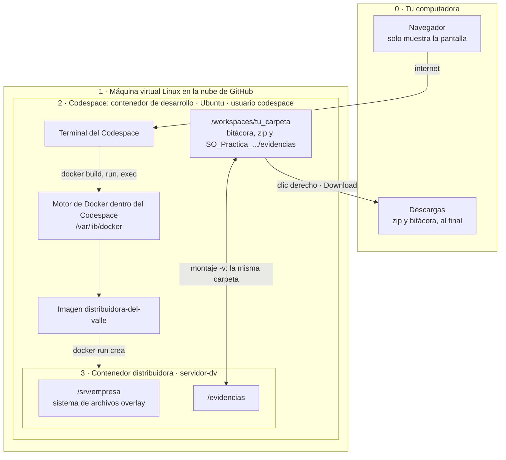
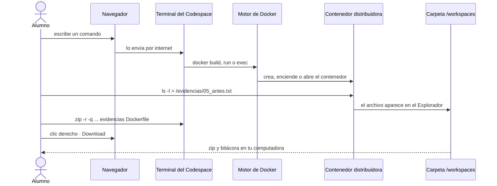
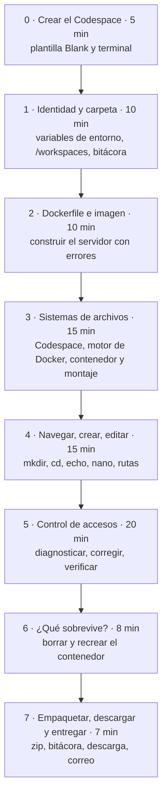
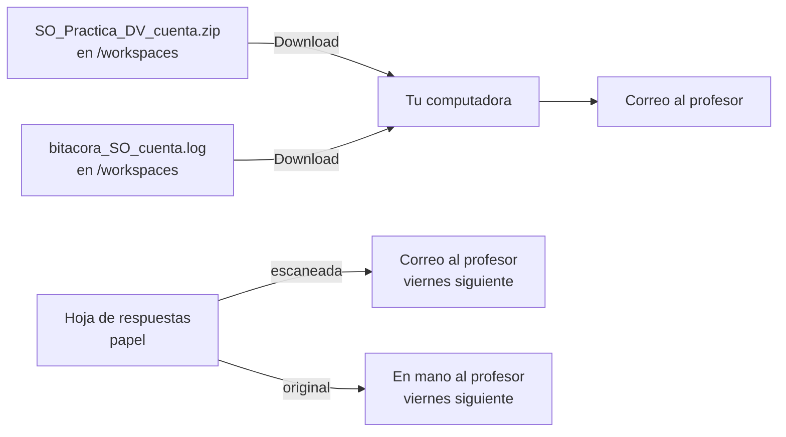

# Práctica · Sistemas de archivos y control de accesos con Docker · Versión GitHub Codespaces

## El caso Distribuidora del Valle, de la teoría a la terminal

| | |
|---|---|
| **Materia** | Sistemas Operativos |
| **Programa** | Licenciatura en Informática Administrativa · 3er semestre · UAEMEX |
| **Duración** | 90 minutos |
| **Modalidad** | Individual, en el navegador con **GitHub Codespaces**: no instalas nada en tu computadora |
| **Entregables** | Correo con el `.zip` de evidencias y la bitácora `.log`, al terminar la clase · Hoja de respuestas escaneada por correo **y** en mano, el viernes siguiente a la práctica |

---

## 1. Objetivos

**Objetivo general.** Que administres, solo con la línea de comandos, un servidor Linux que corre en Docker, y que distingas en todo momento **en qué sistema de archivos estás trabajando** y **quién tiene acceso a qué**.

Al terminar podrás:

1. **Distinguir los sistemas de archivos que conviven** al usar Docker en la nube: el del Codespace, el del motor de Docker y el del contenedor, todos sobre una máquina virtual de GitHub.
2. **Reconocer la nomenclatura de cada uno**: `/workspaces/...` en el Codespace, `/var/lib/docker` en el motor de Docker y `/srv/empresa` en el contenedor, y entender por qué **en tu computadora no hay nada** hasta que lo descargas.
3. **Construir un servidor a partir de un Dockerfile** que reproduce la Distribuidora del Valle con sus errores de seguridad.
4. **Crear estructuras de carpetas, navegar, escribir y editar archivos** con comandos básicos de Linux.
5. **Diagnosticar y corregir permisos** con `ls -l`, `chmod`, `chown`, `su` y `sudo`, actuando siempre con el usuario adecuado.
6. **Dejar evidencia breve y verificable** de tu trabajo en una bitácora y un paquete `.zip`.

**¿Para qué le sirve esto a un administrador informático?** Hoy muchos sistemas de una organización corren en contenedores. Si no sabes dónde quedan los datos, puedes perderlos al borrar un contenedor. Si no sabes quién tiene acceso, puedes exponer la nómina o las contraseñas. Esta práctica entrena ambas cosas.

---

## 2. Antes de la clase (requisitos)

- [ ] Una **cuenta de GitHub** con tu correo verificado. Si no tienes, créala en [github.com/signup](https://github.com/signup) **antes** de la clase.
- [ ] Un **navegador actualizado**: Chrome, Edge, Firefox o Safari.
- [ ] **Internet estable durante toda la práctica**: todo ocurre en la nube.
- [ ] Tiempo disponible en tu **cuota gratuita de Codespaces**. Las cuentas personales incluyen horas gratuitas cada mes y esta práctica usa alrededor de hora y media.
- [ ] Tu **número de cuenta** a la mano.
- [ ] Una **hoja** para tus respuestas y una pluma.

No necesitas instalar Docker ni ningún otro programa.

---

## 3. ¿Qué guía sigo?

| Situación | Abre esta guía |
|---|---|
| Trabajarás en el navegador con GitHub Codespaces | **[CODESPACES.md](CODESPACES.md)** |
| Prefieres tu computadora con Docker Desktop | [README.md](README.md), con [WINDOWS.md](WINDOWS.md) o [MACOS.md](MACOS.md) |

La guía de Codespaces tiene **las mismas secciones, los mismos pasos dentro del contenedor y las mismas evidencias** que las guías para Windows y macOS. Cambian la preparación (sección 0), la carpeta de trabajo (no hay Escritorio) y la entrega (hay que descargar los archivos).

---

## 4. El caso: Distribuidora del Valle

La empresa comparte un servidor Linux. Tú eres parte del equipo de administración.

| Grupo (departamento) | Usuarios |
|---|---|
| `contabilidad` | `ana` (contadora), `marta` (auxiliar contable) |
| `ventas` | `sofia` (jefa de ventas), `luis` (vendedor) |
| `practicantes` | `jorge` (practicante) |
| `sudo` | `admin` (administrador) |

Así está la carpeta compartida `/srv/empresa` cuando el Dockerfile construye el servidor. Tiene los **tres errores** que detectaste en el ejercicio en parejas:

```text
-rw-r--r-- 1 root  root         claves_wifi.txt     ← todos leen las claves
-rw-rw-rw- 1 luis  ventas       clientes.csv        ← cualquiera modifica la base de clientes
drwxr-x--- 2 ana   contabilidad contabilidad
-rw-r--r-- 1 sofia ventas       manual_ventas.pdf
-rw-r----- 1 ana   contabilidad nomina.xlsx
drw-r--r-- 2 jorge practicantes practicas           ← su dueño no puede entrar (falta x)
-rwxr-xr-x 1 root  root         respaldo.sh
drwxrwx--- 2 sofia ventas       ventas
```

---

## 5. Arquitectura: capas una dentro de otra, en la nube



| Nivel | Dónde vive | Ejemplo de ruta | Qué debes recordar |
|---|---|---|---|
| **0 · Tu computadora** | Tu navegador | (ninguna) | Nada de la práctica está aquí hasta que **descargas** tu zip y tu bitácora. |
| **1 · Máquina virtual en la nube** | Un servidor de GitHub, creado solo para tu Codespace | (no la ves) | Su **kernel** es el que usan el Codespace, Docker y el contenedor. |
| **2 · Codespace** | Un contenedor de desarrollo con Ubuntu y el usuario `codespace` | `/workspaces/tu_carpeta/...` | Aquí están tu bitácora y tu zip. Se conserva al **detener** el Codespace, pero **se borra si borras el Codespace**. |
| **Motor de Docker** | Dentro del propio Codespace (*docker-in-docker*) | `/var/lib/docker` | Ahí se guardan imágenes y contenedores. |
| **3 · Contenedor** | Capas `overlay` del motor de Docker | `/srv/empresa` | Lo que cambies aquí **se pierde** al borrar el contenedor. |
| **Montaje** (puente entre 2 y 3) | `/workspaces`, visto desde el contenedor | `/evidencias` = `/workspaces/.../evidencias` | Es **la misma carpeta con dos nombres**. Lo que guardes aquí sobrevive al contenedor. |

### Recorrido de un comando



---

## 6. Flujo de la práctica y tiempos



| Sección | Tiempo | Qué haces | Evidencia que se genera |
|---|---|---|---|
| 0 · Crear el Codespace | 5 min | Crear el Codespace desde la plantilla Blank y comprobar Docker | — |
| 1 · Identidad y carpeta | 10 min | Variables de entorno, carpeta en `/workspaces`, bitácora | `bitacora_SO_<cuenta>.log` |
| 2 · Dockerfile e imagen | 10 min | Escribir el Dockerfile, construir la imagen, crear el contenedor | `Dockerfile` |
| 3 · Sistemas de archivos | 15 min | Comparar Codespace, motor de Docker y contenedor; probar el montaje | `03_contenedor.txt`, `03_desde_contenedor.txt`, `03_desde_anfitrion.txt` |
| 4 · Navegar y editar | 15 min | Estructura de carpetas como sofia, editar con nano, rutas | `04_estructura.txt` |
| 5 · Control de accesos | 20 min | Detectar, comprobar y corregir los tres errores | `05_antes.txt`, `05_despues.txt`, `05_verificacion.txt` |
| 6 · Persistencia | 8 min | Borrar y recrear el contenedor | `06_recreado.txt` |
| 7 · Entrega | 7 min | Cerrar la bitácora, crear el zip, descargarlo, enviar y detener el Codespace | `SO_Practica_DV_<cuenta>.zip` |

---

## 7. Reglas de trabajo

1. **Un comando a la vez.** Lee el comentario (`#`) que está arriba de cada comando antes de ejecutarlo. Entender el *porqué* es parte de la evaluación.
2. **Fíjate dónde estás.** Cada bloque indica si va en la **terminal del Codespace** o **dentro del contenedor**. El prompt te lo confirma: `@tu_usuario ➜ /workspaces/... $` en el Codespace y `root@servidor-dv:/srv/empresa#` en el contenedor.
3. **Dentro del contenedor, regresa siempre a root** (`exit`) antes de cambiar a otro usuario con `su`.
4. **Todo es idempotente.** Si te equivocas o no estás seguro, repite el paso: las carpetas existentes se reutilizan y los archivos se reemplazan. Para reiniciar el servidor con su configuración original, usa el paso 6.1.
5. **Si el Codespace se detiene o abres otra terminal**, ejecuta el *bloque de reanudación* que está al inicio de la guía, en una terminal **nueva**. El Codespace se detiene solo tras 30 minutos sin actividad; tus archivos se conservan.
6. **Los mensajes de error que la guía anuncia son parte del aprendizaje.** `Permission denied` y `Operation not permitted` demuestran que los permisos funcionan.

---

## 8. Evidencias y bitácora

Las salidas están **controladas para ser cortas**: cada evidencia ocupa de una a treinta líneas, la bitácora unas treinta y cinco, y el zip completo pesa menos de 10 KB.

| Archivo | Dónde | Contenido |
|---|---|---|
| `bitacora_SO_<cuenta>.log` | Carpeta de trabajo (`/workspaces/...`) | Tu nombre, número de cuenta, usuario de GitHub, nombre del Codespace (`CODESPACE_NAME`), hora de inicio y fin, kernel y datos del motor de Docker, y un registro por sección. |
| `evidencias/03_contenedor.txt` | Proyecto | Tu identidad vista desde el contenedor, su kernel y sus sistemas de archivos. |
| `evidencias/03_desde_*.txt` | Proyecto | Prueba de que la carpeta montada funciona en ambos sentidos. |
| `evidencias/04_estructura.txt` | Proyecto | Árbol de `ventas` con permisos y el archivo que editaste. |
| `evidencias/05_antes.txt` y `05_despues.txt` | Proyecto | `ls -l` antes y después de corregir. |
| `evidencias/05_verificacion.txt` | Proyecto | Cinco pruebas de acceso con su resultado (0 = permitido). |
| `evidencias/06_recreado.txt` | Proyecto | Estado del servidor después de recrear el contenedor. |
| `SO_Practica_DV_<cuenta>.zip` | Carpeta de trabajo | La carpeta `evidencias` y el `Dockerfile`. Se **descarga** a tu computadora al final. |

---

## 9. Hoja de respuestas

Cada sección termina con una **actividad**. Respóndelas a mano en una hoja que entregarás **el viernes siguiente a la práctica**, escaneada por correo y en mano (ver [Entrega](#10-entrega)).

**Instrucciones para la hoja:**

1. Usa una hoja blanca o de cuaderno. Escribe con pluma y letra legible.
2. En el encabezado anota: **nombre completo, número de cuenta, grupo, fecha** y el título *Práctica: Distribuidora del Valle en Docker*.
3. Anota también *GitHub Codespaces*, tu **usuario de GitHub** y el **nombre de tu Codespace** tal como aparecen en tu bitácora.
4. Numera las respuestas del **1 al 12**. Sé breve: el dato que se pide y una o dos líneas de explicación.
5. Responde **al terminar cada sección**, no al final: así usas tus propios resultados.
6. Es trabajo **individual**. Puedes consultar tus guías y apuntes.
7. **Entrégala el viernes siguiente a la práctica, de dos formas:** escaneada por correo y el original en mano al profesor.

**Las 12 preguntas** (también aparecen al final de cada sección de tu guía):

| # | Sección | Pregunta |
|---|---|---|
| 1 | 1 | ¿Qué ruta mostró tu carpeta de trabajo? ¿Por qué la tomamos de `$PWD` en lugar de escribirla a mano? ¿Qué problema evita? |
| 2 | 1 | ¿Qué es un comando **idempotente**? Escribe uno de la sección 1 que lo sea. |
| 3 | 2 | ¿Cuál es la diferencia entre la **imagen** `distribuidora-del-valle` y el **contenedor** `distribuidora`? |
| 4 | 2 | ¿Para qué le sirve a un administrador describir un servidor en un Dockerfile en lugar de configurarlo a mano? |
| 5 | 3 | Escribe la ruta de tu carpeta de evidencias vista desde el Codespace y desde el contenedor. ¿Por qué es la misma carpeta con dos nombres? |
| 6 | 3 | Compara el kernel del Codespace, el que reporta Docker y el del contenedor. ¿Por qué son iguales? |
| 7 | 4 | Desde `/srv/empresa/ventas/reportes/2026/octubre`, escribe la ruta relativa y la absoluta para llegar a `/srv/empresa/ventas`. |
| 8 | 4 | ¿Por qué sofia pudo crear carpetas dentro de `ventas` y jorge no? Usa la categoría (u, g, o) y el permiso. |
| 9 | 5 | Para cada uno de los tres riesgos, ¿qué comando usaste y quién lo ejecutó? ¿Por qué esa persona? |
| 10 | 5 | ¿Por qué admin necesitó `sudo` para `claves_wifi.txt` y luis no lo necesitó para `clientes.csv`? |
| 11 | 6 | Al borrar y recrear el contenedor, ¿qué se perdió y qué se conservó? ¿Por qué? |
| 12 | 6 | En un servidor real con contenedores, ¿dónde guardarías los datos importantes y por qué? ¿Qué pasaría con tus evidencias si borraras el Codespace antes de descargarlas? |

---

## 10. Entrega



**Al terminar la práctica, antes de salir del salón:**

> **Nota:** la **hoja de respuestas** no se entrega hoy. Se entrega **el viernes siguiente a la práctica**, escaneada por correo **y** en mano (ver más abajo). Hoy solo envías el zip y la bitácora.

1. **Envía un correo** a la dirección que indique el profesor, con:
   - **Asunto:** `[SO] Práctica Distribuidora - <número de cuenta> - <nombre completo>`
   - **Dos archivos adjuntos**, que **descargaste** de tu Codespace en el paso 7.3:
     1. `SO_Practica_DV_<cuenta>.zip`
     2. `bitacora_SO_<cuenta>.log`
   - **Cuerpo del mensaje:**

     ```text
     Nombre: <nombre completo>
     Número de cuenta: <número>
     Grupo: <grupo>
     Sistema usado: GitHub Codespaces (usuario de GitHub: <tu usuario>)
     Adjunto el zip de evidencias y la bitácora de la práctica Distribuidora del Valle.
     ```

**Antes de enviar, revisa:**

- [ ] La bitácora tiene tu nombre, número de cuenta, usuario de GitHub y nombre de tu Codespace.
- [ ] La bitácora llega hasta la sección 7 y tiene hora de fin.
- [ ] El zip contiene la carpeta `evidencias`, con 8 archivos, y el `Dockerfile`.
- [ ] Adjuntaste **los dos** archivos: el zip **y** la bitácora.
- [ ] **Detuviste** tu Codespace (paso 7.5), pero **no lo borraste** hasta que el profesor confirme la recepción.

**El viernes siguiente a la práctica, entrega tu hoja de respuestas de dos formas:**

1. **Escaneada, por correo**, a la misma dirección:
   - **Asunto:** `[SO] Hoja Práctica Distribuidora - <número de cuenta> - <nombre completo>`
   - **Adjunto:** la hoja en **un solo PDF** (puedes usar la función de escanear documentos de la cámara o de una app de tu celular). Revisa que se lean tu nombre, tu número de cuenta y las 12 respuestas.
2. **En mano**: entrega la hoja original al profesor en clase.

---

## 11. Evaluación

| Criterio | Peso | Qué se revisa |
|---|---|---|
| Ejecución completa | 40 % | El zip contiene las 8 evidencias, el Dockerfile sin cambios y resultados coherentes (ver la tabla siguiente). |
| Bitácora | 20 % | Identidad, usuario de GitHub, Codespace, kernel y datos del motor de Docker, y registro de las secciones 1 a 7. |
| Hoja de respuestas | 40 % | 12 respuestas, correctas y justificadas con lo que observaste en tu propia ejecución. |

### Para el profesor: cómo verificar una entrega en un minuto

| Revisa | Resultado esperado |
|---|---|
| `03_contenedor.txt` | La cuenta y el nombre coinciden con la bitácora: llegaron por variables de entorno. |
| Bitácora, líneas *Usuario de GitHub* y *Codespace* | Presentes y coherentes entre sí: el nombre del Codespace suele empezar con el usuario de GitHub. |
| Bitácora, líneas *Kernel del Codespace* y *Kernel visto por Docker* | Las dos iguales entre sí e iguales al kernel de `03_contenedor.txt`: todo corre sobre la misma máquina virtual en la nube. *Motor de Docker* muestra Ubuntu, no Docker Desktop. |
| `04_estructura.txt` | Árbol `reportes/2026/octubre` con dueño `sofia` y la línea `Revisado por: <nombre del alumno>`. |
| `05_antes.txt` y `05_despues.txt` | Antes: `666`, `644` y `drw-r--r--` en los tres archivos con error. Después: `-rw-rw----`, `-rw-------` y `drwx------ sofia ventas`. |
| `05_verificacion.txt` | Pruebas 1 a 4 con resultado `1` (negado) y prueba 5 con `0` (permitido). |
| `06_recreado.txt` | Los permisos originales de nuevo, la línea `No such file or directory` para `03_solo_contenedor.txt` y la lista de evidencias. |

---

## 12. Problemas generales

| Situación | Qué hacer |
|---|---|
| No tengo cuenta de GitHub o no puedo iniciar sesión | Créala en [github.com/signup](https://github.com/signup) y verifica tu correo. Mientras tanto, trabaja en pareja con un compañero, pero **entrega tu propia hoja**. |
| Agoté mi cuota gratuita de Codespaces | Haz la práctica en tu computadora con [README.md](README.md) y la guía de tu sistema. |
| La conexión a internet se cae | El Codespace sigue existiendo. Cuando vuelva la conexión, recarga la pestaña o ábrelo desde [github.com/codespaces](https://github.com/codespaces) y usa el bloque de reanudación. |
| Me perdí y no sé en qué paso voy | Revisa tu bitácora en el Explorador: la última sección registrada es la última que completaste. |
| Quiero empezar el servidor de cero | Ejecuta el paso 6.1 de la guía: recrea el contenedor con la configuración original sin borrar tus evidencias. |

Los problemas propios de Codespaces están al final de [CODESPACES.md](CODESPACES.md#problemas-frecuentes-en-codespaces).

---

## Anexo: fuentes y referencias

**GitHub Codespaces**

1. GitHub Docs. *Creating a codespace from a template.* https://docs.github.com/en/codespaces/developing-in-a-codespace/creating-a-codespace-from-a-template
2. GitHub Docs. *Deep dive into GitHub Codespaces*: máquina virtual por Codespace, contenedor de desarrollo y persistencia de `/workspaces`. https://docs.github.com/en/codespaces/about-codespaces/deep-dive
3. GitHub Docs. *Introduction to dev containers*: imagen Linux por defecto. https://docs.github.com/en/codespaces/setting-up-your-project-for-codespaces/adding-a-dev-container-configuration/introduction-to-dev-containers
4. Dev Containers. *Universal image*, la imagen por defecto de Codespaces: Ubuntu y Docker en modo docker-in-docker. https://github.com/devcontainers/images/tree/main/src/universal
5. GitHub Docs. *Default environment variables for your codespace* (`CODESPACE_NAME`, `GITHUB_USER`). https://docs.github.com/en/codespaces/developing-in-a-codespace/default-environment-variables-for-your-codespace
6. GitHub Docs. *Stopping and starting a codespace.* https://docs.github.com/en/codespaces/developing-in-a-codespace/stopping-and-starting-a-codespace
7. GitHub Docs. *Setting your timeout period for GitHub Codespaces* (30 minutos por defecto). https://docs.github.com/en/codespaces/setting-your-user-preferences/setting-your-timeout-period-for-github-codespaces
8. GitHub Docs. *About billing for GitHub Codespaces* (cuota gratuita). https://docs.github.com/en/billing/managing-billing-for-your-products/managing-billing-for-github-codespaces/about-billing-for-github-codespaces

**Docker**

9. Docker Inc. *What is Docker?* Imágenes, contenedores y arquitectura. https://docs.docker.com/get-started/docker-overview/
10. Docker Inc. *Dockerfile reference.* https://docs.docker.com/reference/dockerfile/
11. Docker Inc. *Storage.* La capa de escritura del contenedor no persiste al destruirlo. https://docs.docker.com/engine/storage/
12. Docker Inc. *Bind mounts.* https://docs.docker.com/engine/storage/bind-mounts/
13. Docker Inc. *docker system info*, incluida la opción `--format`. https://docs.docker.com/reference/cli/docker/system/info/

**Linux: sistemas de archivos y control de accesos**

14. The Linux Kernel documentation. *Overlay Filesystem.* https://docs.kernel.org/filesystems/overlayfs.html
15. Linux Foundation. *Filesystem Hierarchy Standard 3.0.* https://refspecs.linuxfoundation.org/FHS_3.0/fhs/index.html
16. Linux man-pages project. *chmod(1).* https://man7.org/linux/man-pages/man1/chmod.1.html
17. Linux man-pages project. *chown(1).* https://man7.org/linux/man-pages/man1/chown.1.html
18. Linux man-pages project. *su(1).* https://man7.org/linux/man-pages/man1/su.1.html
19. Linux man-pages project. *useradd(8).* https://man7.org/linux/man-pages/man8/useradd.8.html
20. Linux man-pages project. *path_resolution(7)*: rutas y revisión de permisos. https://man7.org/linux/man-pages/man7/path_resolution.7.html
21. Free Software Foundation. *GNU Coreutils: File permissions.* https://www.gnu.org/software/coreutils/manual/html_node/File-permissions.html
22. Miller, T. C. et al. *Sudo Manual.* https://www.sudo.ws/docs/man/sudo.man/
23. Arpaci-Dusseau, R. H. y Arpaci-Dusseau, A. C. (2018). *Operating Systems: Three Easy Pieces*, cap. «Files and Directories». https://pages.cs.wisc.edu/~remzi/OSTEP/file-intro.pdf
