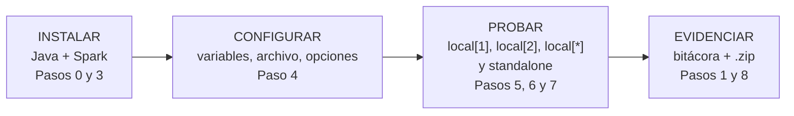
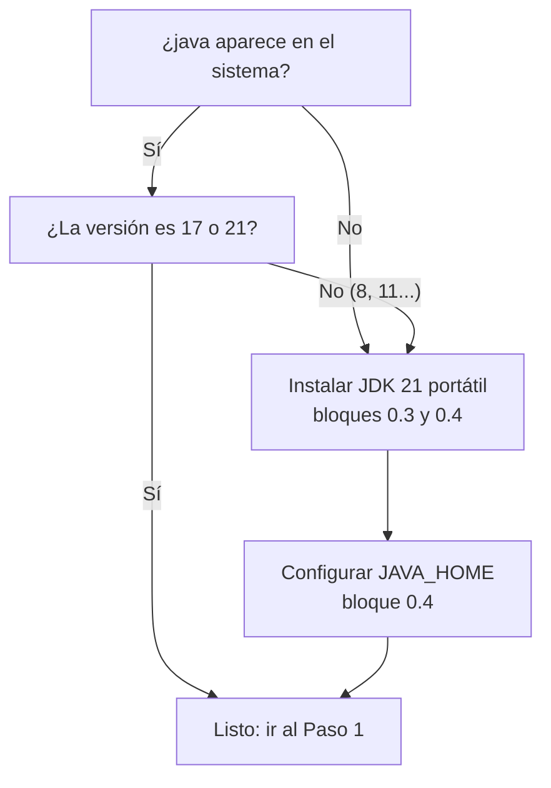
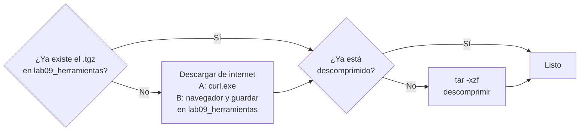
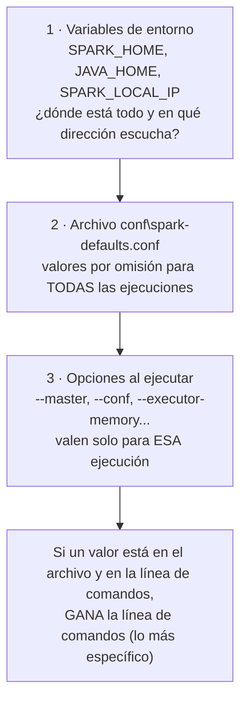
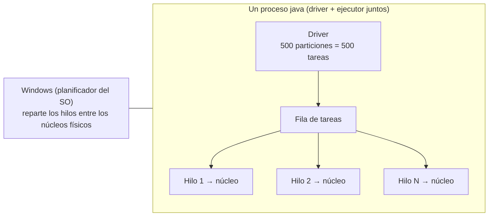
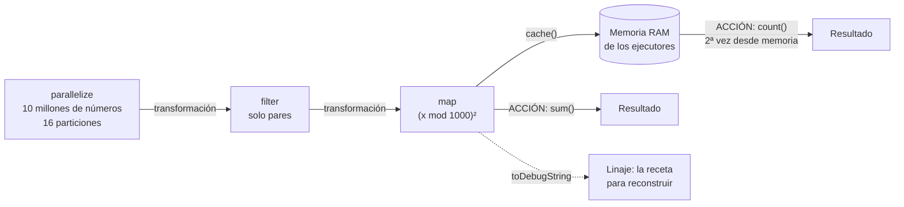
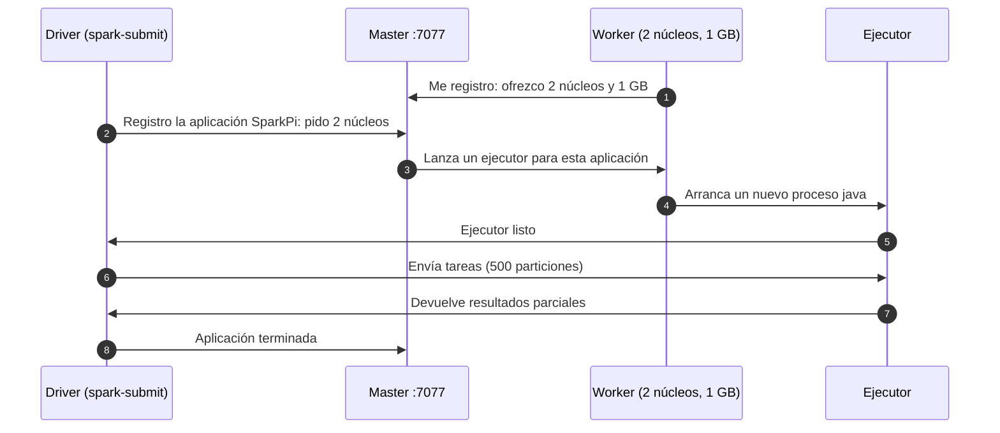

# Lab 09 · Guía paso a paso en PowerShell: Spark en una sola computadora

**Materia:** Sistemas Operativos · **Licenciatura en Informática Administrativa (3er semestre)** · **UAEMEX**
**Duración:** 40 minutos · **En parejas** · **Se sigue al mismo tiempo que el profesor**

---

## Antes de empezar: reglas de trabajo

1. Abre **Windows PowerShell** o **PowerShell 7** de forma normal (**no** como administrador). Menú Inicio → escribe `PowerShell` → Enter.
2. **Copia y pega un bloque completo a la vez** y presiona Enter. Espera a que termine antes de pegar el siguiente.
3. Las líneas que empiezan con `#` son **comentarios**: explican el comando de abajo y PowerShell las ignora.
4. Todos los bloques son **idempotentes**: si un bloque se repite, no falla ni duplica nada. Si te equivocas, **vuelve a pegar el mismo bloque**.
5. **No cierres la ventana** de PowerShell hasta el Paso 8. Si se cierra por accidente, usa el **Anexo A** (bloque de reanudación).
6. Contesta las preguntas **sobre la marcha** en `respuestas_lab09.txt` (se crea en el Paso 1). Hay 12 en total, marcadas con 📝.

> **Idea guía de toda la práctica:** instalar, configurar y probar son **tres trabajos distintos**. Un administrador necesita saber en cuál de los tres está cuando algo falla.



---

## Paso 0 (opcional, idealmente antes de clase) · Confirmar o instalar Java

**Por qué:** Spark está escrito en Scala y se ejecuta dentro de la **máquina virtual de Java (JVM)**. Sin Java, Spark no arranca. **Spark 4 exige Java 17 o 21.**
**Para qué (administrador):** antes de instalar cualquier plataforma, se revisan sus **dependencias**. Una dependencia con la versión equivocada es la causa más común de fallas en una instalación.



### 0.1 Crear la carpeta de herramientas

Usamos `C:\Users\Public` (la variable `$env:PUBLIC`) porque **todos los usuarios pueden escribir ahí** y la ruta **no tiene espacios ni acentos**, algo que los scripts de Spark para Windows necesitan.

```powershell
# Ruta de herramientas: C:\Users\Public\lab09_herramientas (sin espacios ni acentos)
$HERR = Join-Path $env:PUBLIC "lab09_herramientas"

# Crear la carpeta; -Force evita el error si ya existe. $null = oculta el mensaje de salida
$null = New-Item -ItemType Directory -Path $HERR -Force

# Mostrar la ruta para confirmar
$HERR
```

### 0.2 ¿Ya hay Java? ¿Qué versión?

```powershell
# Buscar el comando java; si no existe, no marca error (SilentlyContinue)
$javaCmd = Get-Command java -ErrorAction SilentlyContinue

# Decir si se encontró y dónde
if ($javaCmd) { Write-Host "Java encontrado en: $($javaCmd.Source)" } else { Write-Host "Java NO esta instalado o no esta en el PATH" }

# Mostrar JAVA_HOME (si está vacío no pasa nada)
Write-Host "JAVA_HOME actual: $env:JAVA_HOME"
```

Si se encontró Java, revisa su versión. `java -version` escribe en el canal de errores (stderr), por eso lo guardamos en un archivo y luego lo mostramos:

```powershell
# Ejecutar "java -version" y guardar lo que imprime en un archivo de texto
Start-Process -FilePath "java" -ArgumentList "-version" -NoNewWindow -Wait -RedirectStandardError "$HERR\java_version_previo.txt"

# Mostrar el contenido: busca "17" o "21" en la primera línea
Get-Content -Path "$HERR\java_version_previo.txt"
```

**Si dice 17 o 21 → salta al Paso 1.** Si no hay Java o la versión es 8 u 11 → continúa con 0.3.

### 0.3 Descargar e instalar un JDK 21 portátil (sin administrador)

Se descarga el **JDK Temurin 21** (Java libre de la fundación Eclipse) en formato .zip: **instalar es solo descomprimir**. No se toca el registro de Windows ni se piden permisos.

```powershell
# Archivo donde se guardará la descarga
$jdkZip = Join-Path $HERR "jdk21.zip"

# Dirección oficial que entrega siempre el JDK 21 más reciente para Windows de 64 bits
$urlJdk = "https://api.adoptium.net/v3/binary/latest/21/ga/windows/x64/jdk/hotspot/normal/eclipse?project=jdk"

# Descargar SOLO si no se ha descargado antes (curl.exe: escribe siempre .exe)
if (-not (Test-Path $jdkZip)) { curl.exe -L -o $jdkZip $urlJdk }

# Carpeta donde se descomprimirá
$jdkDir = Join-Path $HERR "jdk"

# Descomprimir SOLO si la carpeta todavía no existe
if (-not (Test-Path $jdkDir)) { Expand-Archive -Path $jdkZip -DestinationPath $jdkDir }

# El .zip trae una subcarpeta como "jdk-21.0.x+y"; tomamos su ruta completa
$jdkHome = (Get-ChildItem -Path $jdkDir -Directory)[0].FullName
$jdkHome
```

> Alternativa con instalador (puede pedir administrador): `winget install --id EclipseAdoptium.Temurin.21.JDK -e`

### 0.4 Configurar `JAVA_HOME`

`JAVA_HOME` le dice a Spark **dónde está Java**. La definimos dos veces: para **esta ventana** (`$env:`) y para **tu usuario** (permanente, sirve en ventanas nuevas).

```powershell
# Variable de sesión: válida solo en esta ventana de PowerShell
$env:JAVA_HOME = $jdkHome

# Agregar java al PATH de esta sesión solo si aún no está (evita duplicarlo)
if ($env:Path -notlike "*$jdkHome\bin*") { $env:Path = "$jdkHome\bin;$env:Path" }

# Variable de usuario: queda guardada para las próximas ventanas (no requiere administrador)
[Environment]::SetEnvironmentVariable("JAVA_HOME", $jdkHome, "User")

# Comprobar
Write-Host "JAVA_HOME = $env:JAVA_HOME"
```

---

## Paso 1 · Carpeta del proyecto, identidad y bitácora · ⏱ 0–5 min

**Por qué:** todo lo que hagamos debe quedar **en un solo lugar** y **registrado**.
**Para qué (administrador):** una bitácora responde las preguntas de una auditoría: **quién** hizo el cambio, **cuándo**, **en qué equipo** y **con qué resultado**. Sin bitácora, un cambio no se puede demostrar.

### 1.1 Encontrar el Escritorio real y crear la carpeta del proyecto

El Escritorio no siempre está en el mismo lugar: puede llamarse `Desktop` o `Escritorio`, y si hay OneDrive vive en `...\OneDrive\Escritorio`. El comando `[Environment]::GetFolderPath("Desktop")` le pregunta **a Windows** la ruta correcta, sin importar idioma ni versión.

```powershell
# Preguntar a Windows la ruta real del Escritorio (funciona en Win 10/11, español o inglés, con o sin OneDrive)
$ESCRITORIO = [Environment]::GetFolderPath("Desktop")
$ESCRITORIO

# Ruta de la carpeta del proyecto en el Escritorio
$LAB = Join-Path $ESCRITORIO "lab_09_spark_local"

# Crear la carpeta; -Force: si ya existe no marca error
$null = New-Item -ItemType Directory -Path $LAB -Force

# Carpeta de herramientas (la misma del Paso 0; se vuelve a definir por si lo saltaste)
$HERR = Join-Path $env:PUBLIC "lab09_herramientas"
$null = New-Item -ItemType Directory -Path $HERR -Force
```

### 1.2 Entrar a la carpeta `lab_09_spark_local`

`cd` es el nombre corto de `Set-Location`: cambia la **carpeta de trabajo**. A partir de aquí, los archivos que se creen sin ruta completa quedarán en esta carpeta.

```powershell
# Entrar a la carpeta del proyecto (cd = Set-Location)
cd $LAB

# Forma equivalente escribiendo la ruta explícita:
# cd "$ESCRITORIO\lab_09_spark_local"

# Confirmar en qué carpeta estamos
Get-Location
```

### 1.3 Registrar la identidad de la pareja

Usamos **variables de entorno** (`$env:NOMBRE`): son datos con nombre que el sistema operativo entrega a los programas que se ejecuten desde esta ventana. Quedarán impresas en la bitácora. **Cambia los valores de ejemplo por los suyos.**

```powershell
# Integrante 1: número de cuenta y nombre completo (CAMBIAR)
$env:ALUMNO1_CUENTA = "1234567"
$env:ALUMNO1_NOMBRE = "Nombre Apellido Apellido"

# Integrante 2 (CAMBIAR)
$env:ALUMNO2_CUENTA = "7654321"
$env:ALUMNO2_NOMBRE = "Nombre Apellido Apellido"

# Grupo (CAMBIAR)
$env:LAB_GRUPO = "LIA-3xx"
```

### 1.4 Iniciar la bitácora con `Start-Transcript`

`Start-Transcript` graba en un archivo de texto **todo lo que aparece en esta ventana**: comandos y resultados. Se guarda en el Escritorio con el número de cuenta del integrante 1. Con `-Append`, si se repite el bloque, **agrega** al final en lugar de borrar lo anterior.

```powershell
# Nombre del archivo de bitácora: bitacora_lab09_<cuenta>.txt
$nombreBitacora = "bitacora_lab09_" + $env:ALUMNO1_CUENTA + ".txt"

# Ruta completa en el Escritorio
$BITACORA = Join-Path $ESCRITORIO $nombreBitacora

# Si ya había una bitácora activa (por repetir el bloque), detenerla sin mostrar error
try { Stop-Transcript -ErrorAction Stop } catch { }

# Iniciar (o continuar) la bitácora
Start-Transcript -Path $BITACORA -Append
```

### 1.5 Dejar constancia de identidad y del equipo

```powershell
# Mostrar las variables de identidad (todas las que empiezan con ALUMNO)
Get-ChildItem Env:ALUMNO*

# Mostrar el grupo
Get-ChildItem Env:LAB_GRUPO

# Usuario de Windows y nombre del equipo (variables que define el propio sistema operativo)
Write-Host "Usuario de Windows: $env:USERNAME"
Write-Host "Equipo: $env:COMPUTERNAME"

# Fecha y hora de inicio
Get-Date

# Versión de PowerShell
$PSVersionTable.PSVersion
```

### 1.6 ¿Cuántos núcleos y cuánta memoria tenemos?

Esto es **dimensionar**: antes de pedirle a Spark 2 o 4 núcleos hay que saber cuántos existen. Un **núcleo físico** es una unidad real del procesador; un **núcleo lógico** es lo que ve el sistema operativo (con *hyperthreading*, cada físico aparece como dos).

```powershell
# Consultar al sistema operativo: versión de Windows
$so = Get-CimInstance Win32_OperatingSystem

# Consultar el procesador
$cpu = Get-CimInstance Win32_Processor

# Consultar la computadora (memoria total)
$cs = Get-CimInstance Win32_ComputerSystem

# Núcleos lógicos que ve Windows (los usará local[*])
$NUCLEOS = [int]$env:NUMBER_OF_PROCESSORS

# Memoria total en GB, redondeada a un decimal
$ramGB = [math]::Round($cs.TotalPhysicalMemory / 1GB, 1)

# Guardar todo en 01_equipo.txt (evidencia)
Set-Content -Path (Join-Path $LAB "01_equipo.txt") -Encoding UTF8 -Value "Alumno 1: $env:ALUMNO1_CUENTA - $env:ALUMNO1_NOMBRE", "Alumno 2: $env:ALUMNO2_CUENTA - $env:ALUMNO2_NOMBRE", "Grupo: $env:LAB_GRUPO", "Equipo: $env:COMPUTERNAME", "Sistema: $($so.Caption) $($so.Version)", "Procesador: $($cpu.Name)", "Nucleos fisicos: $($cpu.NumberOfCores)", "Nucleos logicos: $NUCLEOS", "Memoria RAM (GB): $ramGB", "Fecha: $(Get-Date)"

# Mostrarlo (queda en la bitácora)
Get-Content -Path (Join-Path $LAB "01_equipo.txt")
```

### 1.7 Crear el archivo de respuestas

Se crea **solo si no existe**, para no borrar lo que ya hayan escrito.

```powershell
# Ruta del archivo de respuestas
$RESP = Join-Path $LAB "respuestas_lab09.txt"

# Crear la plantilla solo la primera vez
if (-not (Test-Path $RESP)) { Set-Content -Path $RESP -Encoding UTF8 -Value "Lab 09 - Spark local - Respuestas", "Alumno 1: $env:ALUMNO1_CUENTA - $env:ALUMNO1_NOMBRE", "Alumno 2: $env:ALUMNO2_CUENTA - $env:ALUMNO2_NOMBRE", "Grupo: $env:LAB_GRUPO", "", "P1:", "", "P2:", "", "P3:", "", "P4:", "", "P5:", "", "P6:", "", "P7:", "", "P8:", "", "P9:", "", "P10:", "", "P11:", "", "P12:" }

# Abrirlo en el Bloc de notas (déjalo abierto y guarda con Ctrl + S cada vez)
notepad $RESP
```

> 📝 **P1.** ¿Por qué usamos `[Environment]::GetFolderPath("Desktop")` en lugar de escribir `C:\Users\...\Desktop`? Menciona dos situaciones en las que la ruta escrita a mano fallaría.
>
> 📝 **P2.** Desde la mirada de un administrador, ¿para qué sirve la bitácora que inicia `Start-Transcript`? Da un ejemplo concreto en una empresa.

---

## Paso 2 · Verificar la versión de Java que usará Spark · ⏱ 5–7 min

**Por qué:** Spark busca Java **primero en `JAVA_HOME`** y, si no existe, en el `PATH`. Verificamos exactamente **el mismo Java que usará Spark**.
**Para qué:** dejar la versión de la dependencia **documentada** como evidencia.

```powershell
# Si JAVA_HOME existe, usar ese java.exe; si no, usar el que esté en el PATH
if ($env:JAVA_HOME) { $JAVA_EXE = Join-Path $env:JAVA_HOME "bin\java.exe" } else { $JAVA_EXE = "java" }

# Mostrar cuál se va a usar
Write-Host "Java que usara Spark: $JAVA_EXE"

# Ejecutar "java -version" y guardar la respuesta como evidencia
Start-Process -FilePath $JAVA_EXE -ArgumentList "-version" -NoNewWindow -Wait -RedirectStandardError (Join-Path $LAB "02_java_version.txt")

# Mostrar la versión (debe decir 17 o 21)
Get-Content -Path (Join-Path $LAB "02_java_version.txt")
```

> Si aparece un error o una versión menor a 17, regresa al **Paso 0** (bloques 0.3 y 0.4) y repite este paso.

> 📝 **P3.** No vamos a programar en Java, pero Spark lo necesita. ¿Qué es la JVM y por qué gracias a ella **el mismo** Spark funciona en Windows y en Linux?

---

## Paso 3 · Instalar Spark · ⏱ 7–12 min

**Por qué:** Spark para Windows **no tiene instalador**: se distribuye como un archivo comprimido `.tgz` ya compilado. **Instalar es descargar y descomprimir.**
**Para qué:** al no tocar el registro ni pedir administrador, se pueden tener **varias versiones lado a lado** y borrar una sin afectar al sistema. Es una práctica común en servidores.



### 3.1 Definir versión y rutas

```powershell
# Versión de Spark que usaremos (el profesor puede cambiarla)
$SPARK_VER = "4.2.1"

# Nombre del paquete: spark-4.2.1-bin-hadoop3
$SPARK_PAQ = "spark-" + $SPARK_VER + "-bin-hadoop3"

# Ruta del archivo comprimido dentro de la carpeta de herramientas
$SPARK_TGZ = Join-Path $HERR ($SPARK_PAQ + ".tgz")

# Dirección de descarga principal (servidor de Apache)
$URL_SPARK = "https://dlcdn.apache.org/spark/spark-" + $SPARK_VER + "/" + $SPARK_PAQ + ".tgz"

# Dirección de respaldo (archivo histórico de Apache: tiene todas las versiones, pero es más lento)
$URL_SPARK_ARCHIVO = "https://archive.apache.org/dist/spark/spark-" + $SPARK_VER + "/" + $SPARK_PAQ + ".tgz"
```

### 3.2 Descargar Spark de internet (elige UNA opción)

El archivo pesa entre 400 y 500 MB. Estas son las direcciones oficiales de Apache para la versión 4.2.1:

| Servidor | Dirección |
|---|---|
| Principal (más rápido) | https://dlcdn.apache.org/spark/spark-4.2.1/spark-4.2.1-bin-hadoop3.tgz |
| Respaldo (archivo histórico, todas las versiones) | https://archive.apache.org/dist/spark/spark-4.2.1/spark-4.2.1-bin-hadoop3.tgz |
| Página de descargas (para elegir otra versión) | https://spark.apache.org/downloads.html |

Primero imprime las direcciones y el lugar exacto donde debe quedar el archivo:

```powershell
# Mostrar la dirección principal de descarga
Write-Host "Descarga principal: $URL_SPARK"

# Mostrar la dirección de respaldo
Write-Host "Descarga de respaldo: $URL_SPARK_ARCHIVO"

# Mostrar dónde debe quedar guardado el archivo (ruta y nombre exactos)
Write-Host "El archivo debe quedar en: $SPARK_TGZ"
```

**Opción A · Descargar con `curl.exe` desde PowerShell (recomendada).** La descarga queda directo en la carpeta de herramientas y se ve el avance en la consola.

```powershell
# Descargar del servidor principal solo si el archivo no existe (--fail: no guarda páginas de error)
if (-not (Test-Path $SPARK_TGZ)) { curl.exe -L --fail -o $SPARK_TGZ $URL_SPARK }

# Si el servidor principal ya no tiene esa versión, intentar con el archivo histórico
if (-not (Test-Path $SPARK_TGZ)) { curl.exe -L --fail -o $SPARK_TGZ $URL_SPARK_ARCHIVO }

# Confirmar que el archivo quedó en su lugar (debe decir True)
Test-Path $SPARK_TGZ
```

**Opción B · Descargar manualmente con el navegador.** Úsala si `curl.exe` falla (por ejemplo, por un proxy de la red escolar).

1. Abre la carpeta de destino y la descarga con estos comandos:

```powershell
# Abrir en el Explorador la carpeta donde debe quedar el archivo
explorer $HERR

# Abrir la dirección de descarga en el navegador predeterminado
Start-Process $URL_SPARK
```

2. Cuando el navegador pregunte dónde guardar (o al usar **Guardar como**), elige la carpeta **`C:\Users\Public\lab09_herramientas`** y **no cambies el nombre**: `spark-4.2.1-bin-hadoop3.tgz`.
3. Si el navegador lo guardó solo en **Descargas**, este bloque lo mueve a su lugar. Pregunta a Windows dónde está la carpeta Descargas (funciona en español o en inglés):

```powershell
# Preguntar a Windows la ruta real de la carpeta Descargas
$DESCARGAS = (New-Object -ComObject Shell.Application).NameSpace("shell:Downloads").Self.Path
$DESCARGAS

# Ruta donde quedó el archivo descargado por el navegador
$TGZ_DESCARGADO = Join-Path $DESCARGAS ($SPARK_PAQ + ".tgz")

# Moverlo a la carpeta de herramientas, solo si está en Descargas y aún no está en su lugar
if ((Test-Path $TGZ_DESCARGADO) -and (-not (Test-Path $SPARK_TGZ))) { Move-Item -Path $TGZ_DESCARGADO -Destination $SPARK_TGZ }

# Confirmar que el archivo quedó en su lugar (debe decir True)
Test-Path $SPARK_TGZ
```

> Espera a que el navegador **termine** la descarga antes de mover el archivo. Mientras descarga, Chrome y Edge lo nombran con terminación `.crdownload` o `.partial`.

### 3.3 Revisar y descomprimir

```powershell
# Ver el tamaño en MB: debe ser de varios cientos; si es casi 0, la descarga falló (bórralo y repite 3.2)
[math]::Round((Get-Item $SPARK_TGZ).Length / 1MB, 1)

# Carpeta que resultará al descomprimir
$SPARK_DIR = Join-Path $HERR $SPARK_PAQ

# Descomprimir con tar (incluido en Windows 10/11) solo si aún no está descomprimido
if (-not (Test-Path $SPARK_DIR)) { tar -xzf $SPARK_TGZ -C $HERR }

# Ver qué trae la instalación
Get-ChildItem -Path $SPARK_DIR

# Ver los lanzadores para Windows (.cmd) que usaremos
Get-ChildItem -Path (Join-Path $SPARK_DIR "bin") -Filter "*.cmd"
```

Carpetas importantes: **`bin`** (programas para lanzar Spark), **`conf`** (configuración), **`jars`** (las bibliotecas de Spark), **`examples`** (programas de ejemplo que usaremos para probar).

> 📝 **P4.** ¿Por qué instalamos Spark en `C:\Users\Public\lab09_herramientas` y no dentro de la carpeta del Escritorio? ¿Qué problema evitamos?

---

## Paso 4 · Configurar Spark y hacer la primera prueba · ⏱ 12–17 min

**Por qué:** una plataforma instalada pero mal configurada **no funciona** o funciona con valores que nadie eligió.
**Para qué (administrador):** en Spark hay **tres niveles** de configuración. Saber **cuál manda** evita horas de búsqueda cuando "el cambio no se aplica".



### 4.1 Variables de entorno de Spark

```powershell
# SPARK_HOME: dónde está instalado Spark (sesión actual)
$env:SPARK_HOME = Join-Path $HERR $SPARK_PAQ

# Agregar la carpeta bin de Spark al PATH de la sesión, solo si no está
if ($env:Path -notlike "*$env:SPARK_HOME\bin*") { $env:Path = "$env:SPARK_HOME\bin;$env:Path" }

# Guardar SPARK_HOME también para el usuario (permanente)
[Environment]::SetEnvironmentVariable("SPARK_HOME", $env:SPARK_HOME, "User")

# Que Spark escuche solo en esta misma computadora (127.0.0.1): nada sale a la red
$env:SPARK_LOCAL_IP = "127.0.0.1"

# Carpeta para los archivos temporales de Spark (ruta sin espacios)
$env:SPARK_LOCAL_DIRS = Join-Path $HERR "tmp"
$null = New-Item -ItemType Directory -Path $env:SPARK_LOCAL_DIRS -Force

# Memoria para los procesos master y worker del Paso 7 (para no saturar el equipo)
$env:SPARK_DAEMON_MEMORY = "512m"

# Mostrar todas las variables que empiezan con SPARK
Get-ChildItem Env:SPARK*
```

### 4.2 Atajos a los programas de Spark

```powershell
# Lanzador para enviar aplicaciones (driver)
$SUBMIT = Join-Path $env:SPARK_HOME "bin\spark-submit.cmd"

# Consola interactiva de Spark (Scala)
$SHELL_SPARK = Join-Path $env:SPARK_HOME "bin\spark-shell.cmd"

# Lanzador de procesos internos (lo usaremos para el master y el worker)
$CLASS = Join-Path $env:SPARK_HOME "bin\spark-class.cmd"

# Buscar el .jar de ejemplos (su nombre cambia con la versión) y tomar su ruta completa
$JAR_EJEMPLOS = (Get-ChildItem -Path (Join-Path $env:SPARK_HOME "examples\jars") -Filter "spark-examples*.jar")[0].FullName
$JAR_EJEMPLOS
```

### 4.3 Archivo de configuración `spark-defaults.conf`

Cada línea es **nombre-de-la-propiedad** y **valor**. Lo escribimos completo cada vez (`Set-Content` reemplaza el archivo), por eso el bloque es idempotente.

| Propiedad | Valor | Por qué |
|---|---|---|
| `spark.master` | `local[2]` | Si no se indica `--master`, usar 2 núcleos |
| `spark.api.mode` | `classic` | Modo clásico de Spark: permite usar `sc` (SparkContext) en el Paso 6 |
| `spark.sql.catalogImplementation` | `in-memory` | Catálogo de tablas en memoria: evita que Windows pida componentes de Hive/Hadoop |
| `spark.ui.showConsoleProgress` | `false` | Sin barra de progreso: logs más limpios |
| `spark.driver.memory` | `1g` | Memoria del driver: suficiente para el laboratorio |

```powershell
# Ruta del archivo de configuración de Spark
$CONF = Join-Path $env:SPARK_HOME "conf\spark-defaults.conf"

# Escribir el archivo completo (ASCII: sin acentos, como lo espera Spark)
Set-Content -Path $CONF -Encoding ASCII -Value "spark.master                     local[2]", "spark.api.mode                   classic", "spark.sql.catalogImplementation  in-memory", "spark.ui.showConsoleProgress     false", "spark.driver.memory              1g"

# Mostrar el archivo
Get-Content -Path $CONF
```

### 4.4 Primera prueba: ¿Spark responde?

```powershell
# Pedir la versión de Spark; la respuesta se guarda en dos archivos (salida normal y log)
Start-Process -FilePath $SUBMIT -ArgumentList "--version" -NoNewWindow -Wait -RedirectStandardOutput (Join-Path $LAB "03_spark_version_salida.txt") -RedirectStandardError (Join-Path $LAB "03_spark_version.txt")

# Mostrar el letrero de Spark con su versión
Get-Content -Path (Join-Path $LAB "03_spark_version.txt")
```

### 4.5 ¿Qué configuración leyó Spark? (`--verbose`)

Ejecutamos un programa de ejemplo (**SparkPi**, que estima el valor de π) **sin** indicar `--master`. Con `--verbose`, Spark informa qué archivo de configuración leyó y qué valores usó.

```powershell
# Archivos de evidencia
$SALIDA4 = Join-Path $LAB "04_verbose_salida.txt"
$LOG4 = Join-Path $LAB "04_verbose_log.txt"

# Ejecutar SparkPi con 10 particiones, SIN --master, mostrando la configuración usada
Start-Process -FilePath $SUBMIT -ArgumentList "--verbose", "--class", "org.apache.spark.examples.SparkPi", $JAR_EJEMPLOS, "10" -NoNewWindow -Wait -RedirectStandardOutput $SALIDA4 -RedirectStandardError $LOG4

# Buscar en ambos archivos: qué archivo de propiedades leyó, qué master usó y el resultado
Select-String -Path (Join-Path $LAB "04_verbose_*.txt") -Pattern "properties file", "spark.master", "Pi is roughly"

# Guardar una copia de la configuración usada como evidencia
Copy-Item -Path $CONF -Destination (Join-Path $LAB "04_spark-defaults.conf") -Force
```

> Verás avisos como `Did not find winutils.exe`: Spark busca herramientas de Hadoop para Windows que **no necesitamos** hoy. Es un aviso, no un error.

> 📝 **P5.** ¿Qué diferencia hay entre una variable definida con `$env:` y una guardada con `SetEnvironmentVariable(..., "User")`? ¿Cuál sobrevive si cierras la ventana?
>
> 📝 **P6.** Según la salida de `--verbose`, ¿qué master usó Spark si no escribimos `--master`, y de dónde salió ese valor? Si en el Paso 5 escribimos `--master local[1]`, ¿qué valor gana y por qué?

---

## Paso 5 · Paralelismo por núcleos: `local[1]`, `local[2]` y `local[*]` · ⏱ 17–25 min

**Por qué:** en modo local, Spark crea **un solo proceso** y dentro de él tantos **hilos de trabajo** como núcleos le pidamos. Cada **partición** de los datos se convierte en una **tarea**, y cada hilo toma tareas de una fila, como cajeras atendiendo una sola fila del banco.
**Para qué (administrador):** medir antes de comprar. Si con 4 núcleos el trabajo no mejora, más hardware no es la solución.



| `--master` | Hilos de trabajo |
|---|---|
| `local` o `local[1]` | 1 |
| `local[2]` | 2 |
| `local[*]` | Uno por cada núcleo lógico (el valor `$NUCLEOS` del Paso 1) |

### 5.1 Preparar la tabla de tiempos

```powershell
# Archivo CSV donde guardaremos los tiempos
$CSV = Join-Path $LAB "05_tiempos.csv"

# Borrarlo si existe, para que al repetir la práctica la tabla empiece limpia
Remove-Item -Path $CSV -ErrorAction SilentlyContinue

# Número de particiones (y por lo tanto de tareas) para SparkPi
$PARTES = "500"

# Abrir el Administrador de tareas para ver los núcleos trabajando
# (pestaña Rendimiento → CPU → clic derecho en la gráfica → Cambiar gráfico a → Procesadores lógicos)
Start-Process taskmgr
```

### 5.2 Primera corrida: un solo núcleo

Estas dos variables son **lo único que cambia** entre corridas.

```powershell
# Configuración de esta corrida: 1 hilo
$MODO = "local[1]"

# Etiqueta para los nombres de archivo (los corchetes y * no se permiten en nombres de archivo)
$ETIQUETA = "local1"
```

### 5.3 Ejecutar y medir (bloque reutilizable)

`Measure-Command` cronometra lo que está entre llaves. El tiempo total incluye **arrancar Java**; por eso también leemos el tiempo que Spark reporta **solo para el cálculo**.

```powershell
# Archivos de esta corrida: salida del programa y log de Spark
$SALIDA = Join-Path $LAB ("05_pi_" + $ETIQUETA + "_salida.txt")
$LOG = Join-Path $LAB ("05_pi_" + $ETIQUETA + "_log.txt")

# Ejecutar SparkPi con el modo elegido y medir el tiempo total
$medida = Measure-Command { Start-Process -FilePath $SUBMIT -ArgumentList "--master", $MODO, "--class", "org.apache.spark.examples.SparkPi", $JAR_EJEMPLOS, $PARTES -NoNewWindow -Wait -RedirectStandardOutput $SALIDA -RedirectStandardError $LOG }
```

### 5.4 Registrar el resultado (bloque reutilizable)

```powershell
# Mostrar el resultado del programa: el valor aproximado de Pi
Get-Content -Path $SALIDA

# Buscar en el log la línea donde Spark informa cuánto tardó el trabajo
$lineaJob = Select-String -Path $LOG -Pattern "Job 0 finished"
$lineaJob

# Quedarnos solo con el tiempo (lo que aparece después de "took ")
$tiempoJob = ($lineaJob.Line -split "took ")[1]

# Contar las tareas terminadas (debe coincidir con el número de particiones)
$tareas = (Select-String -Path $LOG -Pattern "Finished task .* ms on ").Count

# Tiempo total medido por PowerShell, redondeado a un decimal
$segundos = [math]::Round($medida.TotalSeconds, 1)

# Armar un registro con los datos de esta corrida
$registro = [PSCustomObject]@{ Modo = $MODO; Tareas = $tareas; Segundos_totales = $segundos; Tiempo_job = $tiempoJob }

# Agregar el registro al CSV
Export-Csv -InputObject $registro -Path $CSV -Append -NoTypeInformation -Encoding UTF8

# Mostrarlo en pantalla (queda en la bitácora)
$registro
```

### 5.5 Segunda corrida: dos núcleos

Pega este bloque y **luego vuelve a pegar los bloques 5.3 y 5.4** sin cambiarles nada.

```powershell
# Configuración de esta corrida: 2 hilos
$MODO = "local[2]"
$ETIQUETA = "local2"
```

### 5.6 Tercera corrida: todos los núcleos

Pega este bloque y **vuelve a pegar 5.3 y 5.4**. Mientras corre, mira el Administrador de tareas.

```powershell
# Configuración de esta corrida: un hilo por núcleo lógico
$MODO = "local[*]"
$ETIQUETA = "localtodos"
```

### 5.7 Comparar

```powershell
# Mostrar la tabla con las tres corridas
Import-Csv -Path $CSV

# Recordar cuántos núcleos lógicos tiene el equipo
Write-Host "Nucleos logicos de este equipo: $NUCLEOS"
```

> 📝 **P7.** Copia los tiempos de `local[1]`, `local[2]` y `local[*]`. Al pasar de 1 a 2 núcleos, ¿el tiempo se redujo exactamente a la mitad? Da **dos** razones de por qué no (pista: arranque de Java, coordinación del driver, núcleos lógicos contra físicos).
>
> 📝 **P8.** ¿Cuántas tareas terminó Spark en cada corrida? ¿Por qué coincide con el número que pusimos en `$PARTES`? Explica con tus palabras la relación entre **partición**, **tarea** y **hilo**.

---

## Paso 6 · Mirar por dentro: particiones, hilos, caché y linaje · ⏱ 25–31 min

**Por qué:** SparkPi demuestra el paralelismo, pero no deja ver **qué pasa dentro**. Un pequeño script en Scala nos mostrará los conceptos de las sesiones anteriores **funcionando en nuestra máquina**.
**Para qué:** reconocer en la práctica lo que un proveedor promete en papel: evaluación perezosa, caché en memoria y recuperación por linaje.



### 6.1 Crear el script

El script va entre `@'` y `'@`. **Copia el bloque completo** (la línea `'@` final debe quedar pegada al margen izquierdo). El archivo se guarda sin acentos porque Java lo lee como texto simple.

```powershell
# Ruta del script de exploración
$SCALA = Join-Path $LAB "06_explorar.scala"

# Contenido del script (texto literal entre @' y '@)
$codigo = @'
// Lab 09 - Paso 6: mirar por dentro de Spark en modo local
println("=== 1. CONFIGURACION ===")
println("Master usado: " + sc.master)
println("Paralelismo por defecto (hilos de trabajo): " + sc.defaultParallelism)
println("Nucleos logicos que ve la JVM: " + Runtime.getRuntime.availableProcessors)

println("=== 2. PARTICIONES ===")
val numeros = sc.parallelize(1L to 10000000L, 16)
println("Numero de particiones: " + numeros.getNumPartitions)

println("=== 3. QUE HILO PROCESA CADA PARTICION ===")
val quien = numeros.mapPartitionsWithIndex((p, it) => Iterator((p, Thread.currentThread.getId, it.map(x => math.sqrt(x.toDouble)).sum)))
val filas = quien.collect()
filas.foreach(f => println("Particion " + f._1 + " procesada por el hilo " + f._2))
println("Hilos distintos que trabajaron: " + filas.map(_._2).distinct.length)

println("=== 4. TRANSFORMACIONES (perezosas) Y ACCION ===")
val pares = numeros.filter(x => x % 2 == 0)
val cuadrados = pares.map(x => (x % 1000) * (x % 1000))
println("Hasta aqui Spark no ha calculado nada: solo anoto el plan")
var t0 = System.nanoTime
println("Suma (accion): " + cuadrados.sum())
println("Tiempo de la suma sin cache (ms): " + (System.nanoTime - t0) / 1000000)

println("=== 5. CACHE EN MEMORIA ===")
cuadrados.cache()
t0 = System.nanoTime
println("Conteo 1 (calcula y guarda en memoria): " + cuadrados.count())
println("Tiempo conteo 1 (ms): " + (System.nanoTime - t0) / 1000000)
t0 = System.nanoTime
println("Conteo 2 (lee desde memoria): " + cuadrados.count())
println("Tiempo conteo 2 (ms): " + (System.nanoTime - t0) / 1000000)

println("=== 6. LINAJE (la receta para reconstruir) ===")
println(cuadrados.toDebugString)

println("=== 7. DATAFRAME Y SQL ===")
val ventas = spark.range(0, 5000000).selectExpr("id % 10 AS tienda", "id % 997 AS importe")
ventas.createOrReplaceTempView("ventas")
spark.sql("SELECT tienda, SUM(importe) AS total FROM ventas GROUP BY tienda ORDER BY total DESC").show(5)

println("=== 8. PAUSA DE 45 s PARA VER LA CONSOLA WEB EN http://localhost:4040 ===")
Thread.sleep(45000)
System.exit(0)
'@

# Guardar el script en la carpeta del proyecto (ASCII: sin acentos)
Set-Content -Path $SCALA -Value $codigo -Encoding ASCII

# Confirmar que existe y cuántas líneas tiene
(Get-Content -Path $SCALA).Count
```

### 6.2 Ejecutarlo con todos los núcleos

`spark-shell` es la consola interactiva de Spark. En lugar de teclear, le **entregamos el script como entrada** (`-RedirectStandardInput`): lo lee línea por línea como si lo escribiéramos.

**Mientras la terminal espera** (alrededor de un minuto), abre en el navegador **http://localhost:4040** y revisa las pestañas **Jobs**, **Stages**, **Storage** (ahí aparece la caché) y **Executors**. Si no carga, espera unos segundos y recarga.

```powershell
# Archivos de evidencia
$SALIDA6 = Join-Path $LAB "06_explorar_salida.txt"
$LOG6 = Join-Path $LAB "06_explorar_log.txt"

# Ejecutar spark-shell con todos los núcleos, leyendo el script como si lo tecleáramos
Start-Process -FilePath $SHELL_SPARK -ArgumentList "--master", "local[*]" -WorkingDirectory $LAB -NoNewWindow -Wait -RedirectStandardInput $SCALA -RedirectStandardOutput $SALIDA6 -RedirectStandardError $LOG6

# Mostrar las líneas clave del resultado
Select-String -Path $SALIDA6 -Pattern "Master usado", "Paralelismo", "Nucleos", "particiones", "Hilos distintos", "Tiempo"

# Abrir la salida completa para ver el linaje y la tabla de SQL
notepad $SALIDA6
```

> Opcional, si sobra tiempo: repite 6.2 cambiando `"local[*]"` por `"local[2]"` y compara el número de **hilos distintos**.

> 📝 **P9.** ¿Cuántas particiones había y cuántos **hilos distintos** trabajaron? Compáralo con los núcleos lógicos del equipo. ¿Quién decide en qué núcleo físico corre cada hilo: Spark o el sistema operativo?
>
> 📝 **P10.** Compara el tiempo del **conteo 1** y el **conteo 2**. ¿Por qué el segundo es más rápido? Según el linaje que imprimió `toDebugString`, ¿qué haría Spark si se perdiera una partición?

---

## Paso 7 · Mini clúster standalone en una sola computadora · ⏱ 31–37 min

**Por qué:** en el modo local todo vive en un proceso. En un clúster real, cada pieza es un **proceso separado**. El modo **standalone** de Spark permite levantar esas piezas en la misma PC para ver **cómo se comunican**.
**Para qué (administrador):** cada proceso es algo que hay que **arrancar, vigilar, dimensionar y apagar**. Este paso es un ensayo de la administración de un clúster.



### 7.1 Arrancar el master (administrador del clúster)

Se arranca **en segundo plano** (sin `-Wait`). Si ya está escuchando en el puerto 7077, no se arranca otro.

```powershell
# Archivos de evidencia del master
$SALIDA_M = Join-Path $LAB "07_master_salida.txt"
$LOG_M = Join-Path $LAB "07_master_log.txt"

# ¿Ya hay un master escuchando en el puerto 7077?
$masterActivo = Get-NetTCPConnection -LocalPort 7077 -State Listen -ErrorAction SilentlyContinue

# Si no hay, arrancarlo en segundo plano (escucha solo en 127.0.0.1; consola web en el puerto 8080)
if (-not $masterActivo) { Start-Process -FilePath $CLASS -ArgumentList "org.apache.spark.deploy.master.Master", "--host", "127.0.0.1", "--port", "7077", "--webui-port", "8080" -NoNewWindow -RedirectStandardOutput $SALIDA_M -RedirectStandardError $LOG_M }

# Esperar hasta 30 segundos a que el puerto 7077 esté escuchando
$espera = 0
while ((-not (Get-NetTCPConnection -LocalPort 7077 -State Listen -ErrorAction SilentlyContinue)) -and ($espera -lt 30)) { Start-Sleep -Seconds 2; $espera = $espera + 2 }

# Confirmar: debe aparecer una conexión en estado Listen
Get-NetTCPConnection -LocalPort 7077 -State Listen
```

> Si aparece una ventana del **Firewall de Windows**, puedes **cancelar**: todo ocurre dentro de la misma computadora.

### 7.2 Arrancar el worker (el que ofrece núcleos y memoria)

Le permitimos usar **solo 2 núcleos y 1 GB**: así se ve cómo el administrador **limita** recursos.

```powershell
# Archivos de evidencia del worker
$SALIDA_W = Join-Path $LAB "07_worker_salida.txt"
$LOG_W = Join-Path $LAB "07_worker_log.txt"

# Si no hay un worker con consola web en el puerto 8081, arrancarlo y conectarlo al master
if (-not (Get-NetTCPConnection -LocalPort 8081 -State Listen -ErrorAction SilentlyContinue)) { Start-Process -FilePath $CLASS -ArgumentList "org.apache.spark.deploy.worker.Worker", "--host", "127.0.0.1", "--cores", "2", "--memory", "1g", "--webui-port", "8081", "spark://127.0.0.1:7077" -NoNewWindow -RedirectStandardOutput $SALIDA_W -RedirectStandardError $LOG_W }

# Esperar hasta 30 segundos a que el worker esté arriba
$espera = 0
while ((-not (Get-NetTCPConnection -LocalPort 8081 -State Listen -ErrorAction SilentlyContinue)) -and ($espera -lt 30)) { Start-Sleep -Seconds 2; $espera = $espera + 2 }

# Dar unos segundos para que se registre con el master
Start-Sleep -Seconds 5

# Evidencia: el master debe decir que registró un worker
Select-String -Path $LOG_M -Pattern "Registering worker"

# Ver cuántos procesos java hay ahora en el sistema operativo
Get-Process -Name java

# Abrir la consola web del master en el navegador
Start-Process "http://127.0.0.1:8080"
```

### 7.3 Enviar SparkPi al mini clúster

Cambia el `--master` y agregamos dos opciones de recursos. **Recarga la página del master** mientras corre.

```powershell
# Configuración de esta corrida: el master standalone
$MODO = "spark://127.0.0.1:7077"
$ETIQUETA = "standalone"

# Archivos de esta corrida
$SALIDA = Join-Path $LAB ("07_pi_" + $ETIQUETA + "_salida.txt")
$LOG = Join-Path $LAB ("07_pi_" + $ETIQUETA + "_log.txt")

# Ejecutar SparkPi en el clúster: máximo 2 núcleos para la aplicación y 512 MB por ejecutor
$medida = Measure-Command { Start-Process -FilePath $SUBMIT -ArgumentList "--master", $MODO, "--total-executor-cores", "2", "--executor-memory", "512m", "--class", "org.apache.spark.examples.SparkPi", $JAR_EJEMPLOS, $PARTES -NoNewWindow -Wait -RedirectStandardOutput $SALIDA -RedirectStandardError $LOG }
```

### 7.4 Registrar el resultado y revisar evidencias

El registro es **el mismo bloque del 5.4** (aquí repetido para no tener que buscarlo).

```powershell
# Mostrar el resultado de Pi
Get-Content -Path $SALIDA

# Línea con el tiempo del trabajo
$lineaJob = Select-String -Path $LOG -Pattern "Job 0 finished"
$lineaJob

# Tiempo que reporta Spark
$tiempoJob = ($lineaJob.Line -split "took ")[1]

# Tareas terminadas
$tareas = (Select-String -Path $LOG -Pattern "Finished task .* ms on ").Count

# Tiempo total
$segundos = [math]::Round($medida.TotalSeconds, 1)

# Registro y CSV
$registro = [PSCustomObject]@{ Modo = $MODO; Tareas = $tareas; Segundos_totales = $segundos; Tiempo_job = $tiempoJob }
Export-Csv -InputObject $registro -Path $CSV -Append -NoTypeInformation -Encoding UTF8

# Tabla completa: tres corridas locales + standalone
Import-Csv -Path $CSV

# Evidencia: el master registró la aplicación
Select-String -Path $LOG_M -Pattern "Registering app", "Registered app"

# Evidencia: el worker recibió la orden de lanzar un ejecutor
Select-String -Path $LOG_W -Pattern "Asked to launch executor"

# Los registros del ejecutor quedan en la carpeta work de Spark (uno por aplicación)
Get-ChildItem -Path (Join-Path $env:SPARK_HOME "work") -Recurse -Filter "stderr"
```

### 7.5 Apagar el mini clúster

Un administrador **siempre** apaga lo que encendió: en la nube, un clúster olvidado genera una factura enorme. Buscamos qué proceso usa cada puerto y lo detenemos.

```powershell
# Buscar el proceso que escucha en 7077 (master) y detenerlo
$conM = Get-NetTCPConnection -LocalPort 7077 -State Listen -ErrorAction SilentlyContinue
if ($conM) { Stop-Process -Id $conM.OwningProcess -Force -ErrorAction SilentlyContinue }

# Buscar el proceso que escucha en 8081 (worker) y detenerlo
$conW = Get-NetTCPConnection -LocalPort 8081 -State Listen -ErrorAction SilentlyContinue
if ($conW) { Stop-Process -Id $conW.OwningProcess -Force -ErrorAction SilentlyContinue }

# Esperar un momento y confirmar que ya no quedan procesos java (no debe mostrar nada)
Start-Sleep -Seconds 3
Get-Process -Name java -ErrorAction SilentlyContinue
```

> 📝 **P11.** ¿Cuántos procesos `java` viste con `Get-Process` y qué papel tiene cada pieza (master, worker, ejecutor, driver)? ¿Qué limitan las opciones `--cores` del worker y `--total-executor-cores` de la aplicación?

---

## Paso 8 · Cierre, empaquetado y entrega · ⏱ 37–40 min

**Por qué:** un trabajo que no se puede **comprobar** no cuenta como hecho.
**Para qué:** el .zip guarda **qué se produjo**; la bitácora, **quién, cuándo y cómo**. Juntos son la evidencia de una auditoría.

> 📝 **P12.** Como administrador de «El Mercadito», ¿cuándo recomendarías `local[*]` en una sola PC, cuándo un clúster standalone y cuándo un servicio administrado en la nube? Justifica con **costo**, **volumen de datos** y **quién administra el sistema operativo**.

**Antes de seguir: guarda `respuestas_lab09.txt` en el Bloc de notas (Ctrl + S).**


### 8.1 Resumen final en la bitácora

```powershell
# Tabla final de tiempos
Import-Csv -Path $CSV

# Lista de evidencias generadas
Get-ChildItem -Path $LAB

# Hora de término
Get-Date
```

### 8.2 Empaquetar las evidencias en un .zip

```powershell
# Nombre del .zip con los dos números de cuenta
$nombreZip = "lab09_" + $env:ALUMNO1_CUENTA + "_" + $env:ALUMNO2_CUENTA + ".zip"

# Ruta del .zip en el Escritorio
$ZIP = Join-Path $ESCRITORIO $nombreZip

# Comprimir todo el contenido de la carpeta del proyecto; -Force reemplaza el .zip si ya existía
Compress-Archive -Path (Join-Path $LAB "*") -DestinationPath $ZIP -Force

# Confirmar que existe y ver su tamaño
Get-Item -Path $ZIP
```

### 8.3 Cerrar la bitácora y verificarla

```powershell
# Detener la bitácora
Stop-Transcript

# Verificar que la bitácora contiene la identidad de la pareja
Select-String -Path $BITACORA -Pattern "ALUMNO1_CUENTA", "ALUMNO2_CUENTA", "LAB_GRUPO"

# Abrir el Escritorio para ver los dos archivos que se enviarán
explorer $ESCRITORIO
```

### 8.4 Enviar por correo

Un integrante de la pareja envía **un solo correo**:

| Campo | Contenido |
|---|---|
| Para | El correo que indique el profesor |
| Asunto | `[SO] Lab 09 Spark local – CUENTA1 – CUENTA2` |
| Adjunto 1 | `lab09_CUENTA1_CUENTA2.zip` (Escritorio) |
| Adjunto 2 | `bitacora_lab09_CUENTA1.txt` (Escritorio) |
| Cuerpo | Nombre completo y número de cuenta de ambos, y grupo |

> ⚠️ **Los dos adjuntos son obligatorios.** El .zip y la bitácora juntos son los que permiten corroborar la ejecución correcta de **toda** la práctica.

---

## Anexo A · Bloque de reanudación (si se cerró PowerShell)

Abre una ventana nueva, **cambia los datos de identidad** y pega este bloque completo. Vuelve a definir todo y **continúa la misma bitácora**. Después sigue en el paso donde te quedaste (en el Paso 5, vuelve a definir `$MODO` y `$ETIQUETA` antes de 5.3).

```powershell
# Identidad (CAMBIAR por los mismos valores del Paso 1)
$env:ALUMNO1_CUENTA = "1234567"
$env:ALUMNO1_NOMBRE = "Nombre Apellido Apellido"
$env:ALUMNO2_CUENTA = "7654321"
$env:ALUMNO2_NOMBRE = "Nombre Apellido Apellido"
$env:LAB_GRUPO = "LIA-3xx"

# Rutas del Paso 1 y entrada a la carpeta
$ESCRITORIO = [Environment]::GetFolderPath("Desktop")
$LAB = Join-Path $ESCRITORIO "lab_09_spark_local"
$HERR = Join-Path $env:PUBLIC "lab09_herramientas"
$null = New-Item -ItemType Directory -Path $LAB -Force
cd $LAB

# Continuar la misma bitácora
$BITACORA = Join-Path $ESCRITORIO ("bitacora_lab09_" + $env:ALUMNO1_CUENTA + ".txt")
try { Stop-Transcript -ErrorAction Stop } catch { }
Start-Transcript -Path $BITACORA -Append
Write-Host "REANUDACION de la practica"
Get-ChildItem Env:ALUMNO*

# Datos del equipo y archivo de respuestas
$NUCLEOS = [int]$env:NUMBER_OF_PROCESSORS
$RESP = Join-Path $LAB "respuestas_lab09.txt"

# Spark (Paso 3 y 4)
$SPARK_VER = "4.2.1"
$SPARK_PAQ = "spark-" + $SPARK_VER + "-bin-hadoop3"
$env:SPARK_HOME = Join-Path $HERR $SPARK_PAQ
if ($env:Path -notlike "*$env:SPARK_HOME\bin*") { $env:Path = "$env:SPARK_HOME\bin;$env:Path" }
$env:SPARK_LOCAL_IP = "127.0.0.1"
$env:SPARK_LOCAL_DIRS = Join-Path $HERR "tmp"
$env:SPARK_DAEMON_MEMORY = "512m"
$SUBMIT = Join-Path $env:SPARK_HOME "bin\spark-submit.cmd"
$SHELL_SPARK = Join-Path $env:SPARK_HOME "bin\spark-shell.cmd"
$CLASS = Join-Path $env:SPARK_HOME "bin\spark-class.cmd"
$JAR_EJEMPLOS = (Get-ChildItem -Path (Join-Path $env:SPARK_HOME "examples\jars") -Filter "spark-examples*.jar")[0].FullName
$CONF = Join-Path $env:SPARK_HOME "conf\spark-defaults.conf"

# Paso 5 (NO borra el CSV: conserva las corridas ya hechas)
$CSV = Join-Path $LAB "05_tiempos.csv"
$PARTES = "500"

# Paso 6
$SCALA = Join-Path $LAB "06_explorar.scala"

# Confirmar Java (JAVA_HOME de usuario se carga solo en ventanas nuevas)
Write-Host "JAVA_HOME = $env:JAVA_HOME"
Write-Host "SPARK_HOME = $env:SPARK_HOME"
```

---

## Anexo B · Solución de problemas

| Síntoma | Causa probable | Qué hacer |
|---|---|---|
| `curl` pide `Uri` o muestra un error raro | En Windows PowerShell, `curl` sin `.exe` es otro comando | Escribir `curl.exe` |
| `Expand-Archive` o `tar` fallan | Descarga incompleta | Borrar el archivo (`Remove-Item $jdkZip` o `Remove-Item $SPARK_TGZ`) y repetir |
| `UnsupportedClassVersionError` | Spark usa Java 8 u 11 | Paso 0 y revisar `$env:JAVA_HOME` |
| `The system cannot find the path specified` | Spark instalado en una ruta con espacios o acentos | Usar `$env:PUBLIC` como en el Paso 3 |
| `Did not find winutils.exe` | Spark busca herramientas de Hadoop para Windows | Solo es un aviso |
| `Exception while deleting Spark temp dir` al terminar | Windows bloquea archivos abiertos | Inofensivo |
| `05_tiempos.csv` muestra 0 tareas | La corrida falló | Abrir el log con `notepad $LOG` y buscar `ERROR` |
| No carga `http://localhost:4040` | La consola web solo existe mientras corre la aplicación, o se usó el puerto 4041 | Abrirla durante la pausa del Paso 6; probar 4041 |
| El worker no se registra | El master no terminó de arrancar | Repetir el bloque 7.2 (es idempotente) |
| `Compress-Archive` dice que un archivo está en uso | El mini clúster sigue encendido | Ejecutar el bloque 7.5 y repetir 8.2 |
| Se cerró la ventana | — | Anexo A |

---

## Anexo C · Las 12 preguntas en una sola lista

| # | Paso | Pregunta |
|---|---|---|
| P1 | 1 | ¿Por qué usar `GetFolderPath("Desktop")` y no una ruta escrita a mano? Dos situaciones donde fallaría. |
| P2 | 1 | ¿Para qué sirve la bitácora de `Start-Transcript` a un administrador? Ejemplo en una empresa. |
| P3 | 2 | ¿Qué es la JVM y por qué permite que el mismo Spark funcione en Windows y Linux? |
| P4 | 3 | ¿Por qué instalar en `C:\Users\Public\...` y no en el Escritorio? |
| P5 | 4 | Diferencia entre variable `$env:` y variable de usuario. ¿Cuál sobrevive al cerrar la ventana? |
| P6 | 4 | ¿Qué master usó Spark sin `--master` y de dónde salió? Con `--master local[1]`, ¿qué gana y por qué? |
| P7 | 5 | Tiempos de `local[1]`, `local[2]`, `local[*]`. ¿Se redujo a la mitad? Dos razones de por qué no. |
| P8 | 5 | ¿Cuántas tareas y por qué coinciden con `$PARTES`? Relación partición–tarea–hilo. |
| P9 | 6 | ¿Cuántas particiones e hilos distintos? ¿Quién decide el núcleo físico: Spark o el SO? |
| P10 | 6 | Conteo 1 contra conteo 2 con caché. ¿Qué haría Spark si se perdiera una partición, según el linaje? |
| P11 | 7 | ¿Cuántos procesos `java` y qué papel tiene cada pieza? ¿Qué limitan `--cores` y `--total-executor-cores`? |
| P12 | 8 | ¿Cuándo `local[*]`, cuándo standalone y cuándo servicio administrado? Justifica con costo, volumen y SO. |
