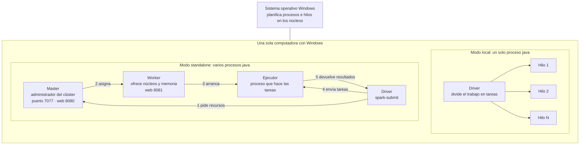
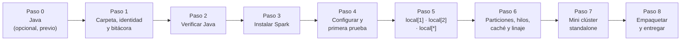
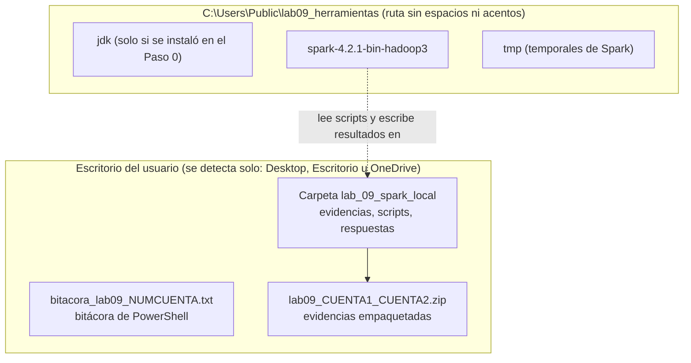

# Lab 09 · Apache Spark en una sola computadora: instalar, configurar y paralelizar por núcleos

**Materia:** Sistemas Operativos · **Carrera:** Licenciatura en Informática Administrativa (3er semestre)
**Universidad Autónoma del Estado de México (UAEMEX)** · **Duración:** 40 minutos · **Modalidad:** en parejas, en clase, siguiendo al profesor
**Tema:** Sistemas operativos modernos: el cómputo distribuido, caso Spark (continuación práctica de las sesiones de Spark)
**Entorno:** Windows 10 u 11 (en español o en inglés) · PowerShell 5.1 o PowerShell 7 · **no requiere permisos de administrador**

---

## 1. ¿De qué trata esta práctica?

En las sesiones anteriores vimos **por qué existe Spark** (los datos ya no caben ni se procesan a tiempo en una sola computadora) y **cómo funciona por dentro** (driver, administrador del clúster, ejecutores, particiones, transformaciones, acciones y linaje).

Hoy lo vamos a **instalar, configurar y probar** en la computadora del laboratorio. No hace falta un clúster de 20 servidores para entender Spark: **una sola computadora con varios núcleos ya es un pequeño sistema paralelo**. Spark puede usar 1, 2 o todos los núcleos, y hasta puede simular un clúster completo (master, worker y ejecutor) dentro de la misma máquina.

### Objetivo de aprendizaje

Al terminar podrás:

1. **Distinguir** los pasos para **instalar** (Java + Spark), **configurar** (variables de entorno, archivo de configuración y opciones al ejecutar) y **probar** Spark.
2. **Comparar** las configuraciones de Spark en una sola computadora: `local[1]`, `local[2]`, `local[*]` y un **mini clúster standalone**.
3. **Medir** el efecto de paralelizar a nivel de núcleo y **explicar** por qué duplicar núcleos no reduce el tiempo exactamente a la mitad.
4. **Relacionar** lo que hace Spark con funciones del sistema operativo: procesos, hilos, memoria y bitácoras.

### ¿Por qué le importa esto a un informático administrativo?

| Lo que hacemos en la práctica | Lo que significa en una empresa |
|---|---|
| Revisar núcleos y memoria antes de instalar | **Dimensionar** el equipo antes de comprar o contratar |
| Instalar sin permisos de administrador y en rutas controladas | **Estandarizar** instalaciones y evitar fallas por rutas mal elegidas |
| Configurar con variables, archivo y opciones | Saber **dónde se cambia** una configuración y **cuál manda** |
| Medir tiempos con 1, 2 y todos los núcleos | Justificar con **datos** si conviene más hardware o no |
| Montar un mini clúster en una PC | Entender qué piezas habría que **administrar** en un clúster real |
| Guardar una bitácora y empaquetar evidencias | **Auditoría**: demostrar qué se hizo, quién, cuándo y con qué resultado |

---

## 2. Arquitectura: las configuraciones que probaremos

En **modo local**, todo vive en **un solo proceso** del sistema operativo (una JVM): el driver y el ejecutor comparten memoria, y cada núcleo se aprovecha con un **hilo** de trabajo. En **modo standalone**, Spark arranca **procesos separados** (master, worker, ejecutor y driver) como si fueran máquinas distintas, aunque todos estén en la misma PC.

| Configuración | Cómo se pide | Qué hace | Cuándo se usa |
|---|---|---|---|
| `local[1]` | `--master local[1]` | Un proceso, **un hilo**: sin paralelismo | Línea base para comparar; depurar errores |
| `local[2]` | `--master local[2]` | Un proceso, **dos hilos** en paralelo | Pruebas controladas; limitar el uso del equipo |
| `local[*]` | `--master local[*]` | Un proceso, **un hilo por núcleo lógico** | Desarrollo y análisis en una laptop o PC |
| Standalone | `--master spark://127.0.0.1:7077` | **Varios procesos**: master, worker, ejecutor y driver | Ensayar cómo se administra un clúster real |
| Clúster real (YARN, Kubernetes, servicio administrado) | `--master yarn`, `k8s://...` | Muchas máquinas | **Fuera del alcance de hoy**; se mencionó en la sesión 2 de Spark |

---

## 3. Flujo de la práctica

| Paso | Contenido | Minutos |
|---|---|---|
| 0 | Confirmar Java 17 o 21; instalarlo si falta (**idealmente antes de clase**) | previo |
| 1 | Carpeta en el Escritorio, identidad de la pareja, bitácora, datos del equipo | 0–5 |
| 2 | Verificar la versión de Java que usará Spark | 5–7 |
| 3 | Descargar Spark de internet (con `curl.exe` o con el navegador) y descomprimirlo | 7–12 |
| 4 | Variables de entorno, `spark-defaults.conf`, `--version` y `--verbose` | 12–17 |
| 5 | Medir `local[1]`, `local[2]` y `local[*]` con SparkPi | 17–25 |
| 6 | Script de exploración: particiones, hilos, caché, linaje y consola web | 25–31 |
| 7 | Mini clúster standalone: master, worker, ejecutor y driver | 31–37 |
| 8 | Limpieza, empaquetado en .zip, cierre de bitácora y entrega | 37–40 |

---

## 4. Archivos de esta práctica

| Archivo | Para qué sirve |
|---|---|
| `README.md` | Este documento: visión general, arquitectura, entrega, rúbrica y notas para el profesor |
| `Lab09_Practica_Spark_Local_PowerShell.md` | La guía paso a paso con todos los comandos de PowerShell comentados y las 12 preguntas |

### Dónde queda cada cosa en la computadora

**¿Por qué dos lugares?** Las evidencias van al **Escritorio** porque es fácil encontrarlas y enviarlas. Las **herramientas** (Java y Spark) van a `C:\Users\Public`, porque los scripts de Spark para Windows fallan con rutas que tienen **espacios o acentos** (por ejemplo `C:\Users\José Pérez\OneDrive\Escritorio`).

### Evidencias que se generan dentro de `lab_09_spark_local`

| Archivo | Paso | Qué demuestra |
|---|---|---|
| `01_equipo.txt` | 1 | Identidad de la pareja, equipo, núcleos y memoria |
| `respuestas_lab09.txt` | 1–8 | Respuestas a las 12 preguntas |
| `02_java_version.txt` | 2 | Versión de Java que usa Spark |
| `03_spark_version*.txt` | 4 | Spark instalado y su versión |
| `04_verbose_*.txt`, `04_spark-defaults.conf` | 4 | Configuración leída y cuál valor ganó |
| `05_pi_local1_*`, `05_pi_local2_*`, `05_pi_localtodos_*` | 5 | Ejecución con 1, 2 y todos los núcleos |
| `05_tiempos.csv` | 5 y 7 | Tabla comparativa de tiempos |
| `06_explorar.scala`, `06_explorar_*.txt` | 6 | Particiones, hilos, caché, linaje y SQL |
| `07_master_*`, `07_worker_*`, `07_pi_standalone_*` | 7 | Mini clúster funcionando |

---

## 5. Requisitos previos

- Computadora con **Windows 10 (versión 1803 o posterior) o Windows 11**. Esas versiones ya incluyen `curl.exe` y `tar.exe`.
- **Al menos 4 GB de RAM** (recomendado 8 GB) y **2 GB libres** en disco.
- **Java 17 o 21**. Spark 4 ya no funciona con Java 8 ni 11. El Paso 0 lo revisa y, si falta, instala una copia portátil sin permisos de administrador.
- **No se necesita Python** ni permisos de administrador.
- **Conexión a internet** para descargar Spark (alrededor de 400–500 MB) desde https://dlcdn.apache.org/spark/spark-4.2.1/spark-4.2.1-bin-hadoop3.tgz

---

## 6. Entrega

Al terminar la práctica, **un integrante de la pareja** envía **un solo correo**:

- **Para:** el correo que indique el profesor.
- **Asunto:** `[SO] Lab 09 Spark local – CUENTA1 – CUENTA2`
- **Adjuntos obligatorios (los dos):**
  1. `lab09_CUENTA1_CUENTA2.zip` — todas las evidencias de la carpeta `lab_09_spark_local`, incluido `respuestas_lab09.txt`.
  2. `bitacora_lab09_CUENTA1.txt` — la bitácora de PowerShell (está en el Escritorio, **fuera** del .zip).
- **Cuerpo del correo:** nombre completo y número de cuenta de ambos integrantes y el grupo.

> **Sin los dos adjuntos no se puede verificar la ejecución.** El .zip demuestra **qué** se produjo; la bitácora demuestra **quién**, **cuándo** y **cómo** se ejecutó cada comando.

---

## 7. Rúbrica (10 puntos)

| Criterio | Puntos | Se cumple cuando… |
|---|---|---|
| Bitácora | 2 | Existe, incluye las variables de identidad (`ALUMNO1_*`, `ALUMNO2_*`, `LAB_GRUPO`) y muestra los pasos 1 a 8 |
| Instalación y configuración | 1.5 | `02_java_version.txt`, `03_spark_version.txt`, `04_verbose_*` y `04_spark-defaults.conf` muestran Java 17+ y Spark funcionando |
| Paralelismo local | 2 | `05_tiempos.csv` tiene las corridas `local[1]`, `local[2]` y `local[*]`, cada una con 500 tareas |
| Exploración | 1 | `06_explorar_salida.txt` muestra particiones, hilos, tiempos de caché y linaje |
| Mini clúster | 1.5 | `07_master_log.txt` registra el worker y la aplicación; `05_tiempos.csv` incluye la corrida standalone |
| Respuestas | 2 | Las 12 preguntas respondidas con palabras propias y con datos de **su** equipo |

Si falta alguno de los dos adjuntos, la práctica se califica sobre la evidencia recibida.

---

## 8. Notas para el profesor

### Preparación antes de la clase (muy recomendable)

1. **Probar la descarga de Spark desde la red del laboratorio.** Descargar 400–500 MB en 30 equipos al mismo tiempo puede tardar; si la red es lenta, pedir que el Paso 3 se haga antes de clase. El Paso 3 ofrece dos vías: `curl.exe` desde PowerShell (opción A) o el navegador, guardando el archivo en `C:\Users\Public\lab09_herramientas` (opción B).
2. **Revisar Java en un equipo de muestra** con el Paso 0. Si los equipos no tienen Java 17 o 21, pedir que el Paso 0 se haga antes de clase o reservar 5 minutos extra.
3. **Ensayar los Pasos 5 a 7** en un equipo del laboratorio: los tiempos varían según el hardware, y conviene saber qué cifras esperar para comentarlas.
4. Ajustar `$SPARK_VER` si para la fecha de la clase existe una versión más nueva. La guía usa **4.2.1** (estable al preparar esta práctica). Si una versión deja de estar en el servidor principal, el Paso 3 recurre al archivo histórico de Apache.

### Durante la clase

- Proyectar la consola con **letra grande** y ejecutar **bloque por bloque**, esperando a que la mayoría termine.
- En el Paso 5, abrir el **Administrador de tareas** con la vista de procesadores lógicos mientras corre `local[*]`: ver todos los núcleos ocupados es la imagen que más fija la idea.
- En el Paso 7, abrir `http://127.0.0.1:8080` para mostrar el worker registrado y la aplicación terminada.
- Si una pareja se atrasa, el **Anexo A** de la guía (bloque de reanudación) le permite retomar en cualquier paso sin repetir todo.

### Problemas más frecuentes

| Síntoma | Causa probable | Qué hacer |
|---|---|---|
| `curl` pide parámetros o muestra un error raro | En Windows PowerShell 5.1, `curl` sin `.exe` es otro comando | Escribir siempre `curl.exe` |
| `UnsupportedClassVersionError` | Spark está usando Java 8 u 11 | Hacer el Paso 0 y revisar `JAVA_HOME` |
| Aviso `Did not find winutils.exe` | Spark busca herramientas de Hadoop para Windows | Es solo un aviso: no afecta esta práctica |
| `ERROR ShutdownHookManager: Exception while deleting Spark temp dir` al terminar | Windows no deja borrar archivos que siguen abiertos | Inofensivo; los resultados son válidos |
| `curl.exe` no descarga (proxy de la red escolar) | La red bloquea descargas desde la consola | Usar la opción B del Paso 3: navegador y guardar en `C:\Users\Public\lab09_herramientas` |
| Ventana del Firewall de Windows | Java abre puertos locales (4040, 7077, 8080) | Se puede **cancelar**: todo ocurre dentro de la misma PC |
| La consola web abre en 4041 en vez de 4040 | El puerto 4040 ya está ocupado | Usar el puerto que indique el navegador o el log |
| El .zip no se crea por un archivo en uso | El mini clúster sigue encendido | Ejecutar el bloque de apagado del Paso 7 |

---

## 9. Referencias

- Apache Spark. *Overview* (requisitos de Java y ejecución local). https://spark.apache.org/docs/latest/
- Apache Spark. *Submitting Applications* (opciones `--master` y `local[N]`). https://spark.apache.org/docs/latest/submitting-applications.html
- Apache Spark. *Spark Configuration* (precedencia de la configuración y `spark-defaults.conf`). https://spark.apache.org/docs/latest/configuration.html
- Apache Spark. *Spark Standalone Mode*. https://spark.apache.org/docs/latest/spark-standalone.html
- Apache Spark. *Cluster Mode Overview* (driver, administrador del clúster y ejecutores). https://spark.apache.org/docs/latest/cluster-overview.html
- Apache Spark. *Spark Release 4.2.0* (notas de la línea 4.2). https://spark.apache.org/releases/spark-release-4-2-0.html
- Eclipse Adoptium. *Temurin JDK* (Java libre usado en el Paso 0). https://adoptium.net/
- Microsoft Learn. *Start-Transcript*. https://learn.microsoft.com/powershell/module/microsoft.powershell.host/start-transcript
- Zaharia, M. y otros (2016). *Apache Spark: A Unified Engine for Big Data Processing*. Communications of the ACM, 59(11).
