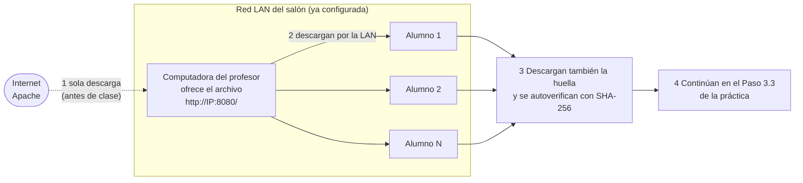
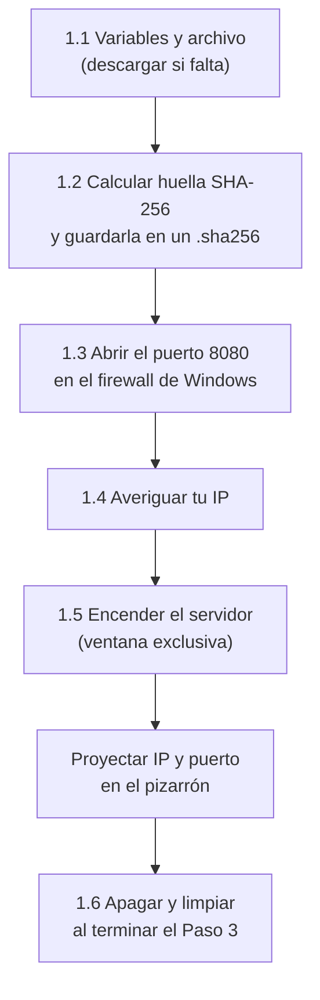

# Contingencia · Descarga de Spark desde la computadora del profesor (red LAN)

**Materia:** Sistemas Operativos · **Licenciatura en Informática Administrativa (3er semestre)** · **UAEMEX**
**Se usa con:** `Lab09_Practica_Spark_Local_PowerShell.md` (reemplaza **solo** el bloque 3.2 «Descargar Spark de internet»)
**Requisito:** la red LAN del salón ya está lista; aquí **no se configura red**, solo se usa. Todo son comandos de PowerShell.

---

## ¿Cuándo se usa este documento?

El Paso 3 de la práctica pide que **todos** los equipos descarguen Spark (alrededor de 400–500 MB) desde internet. Si 30 equipos piden el mismo archivo al mismo tiempo, la salida a internet del salón se satura: unas descargas fallan, otras tardan decenas de minutos y la práctica de 40 minutos no alcanza.

**La solución:** el profesor descarga el archivo **una sola vez** y lo ofrece a través de la red del salón. Los alumnos lo recuperan de **su computadora**, que está en el mismo segmento de red. El tráfico se queda dentro del salón y no consume internet.

> **Por qué le importa a un administrador:** esto es un **repositorio local de instalación** (o *mirror*): una práctica común en empresas para no descargar lo mismo cientos de veces, controlar qué versión se instala y poder instalar aunque no haya internet.



| Quién | Sección | Cuándo |
|---|---|---|
| **Profesor** | Parte 1 (pasos 1.1 a 1.6) | **Antes de la clase** (1.1 a 1.4) y al empezar el Paso 3 (1.5). Al final, 1.6 |
| **Alumnos** | Parte 2 (pasos 2.1 a 2.5) | Cuando el profesor indique que el servidor está encendido |

**Qué se ofrece en la red:** `spark-4.2.1-bin-hadoop3.tgz` (Spark 4.2.1 con las bibliotecas de Hadoop incluidas), su archivo de huella `spark-4.2.1-bin-hadoop3.tgz.sha256` (el alumno lo descarga y **verifica solo**, sin teclear nada) y, por si lo necesitan, `jdk21.zip` (Java). Solo esos tres nombres; cualquier otra petición se rechaza.

---
---

# PARTE 1 · Profesor: dejar el archivo disponible en la red

> Todos los bloques de esta parte son idempotentes: si los repites no fallan ni duplican nada.
> **Abre dos ventanas de PowerShell como administrador** (menú Inicio → `PowerShell` → clic derecho → *Ejecutar como administrador*): una para preparar (1.1 a 1.4) y otra **exclusiva** para el servidor (1.5), porque esa ventana se queda ocupada atendiendo descargas.



## 1.1 Variables y archivo de Spark

**Por qué:** el servidor necesita saber **qué archivo** ofrecer y **en qué puerto**. Si el archivo no está (porque aún no lo descargaste), se baja una sola vez.

```powershell
# Carpeta de herramientas de la práctica (la misma del Paso 0 de la guía)
$HERR = Join-Path $env:PUBLIC "lab09_herramientas"

# Crear la carpeta si no existe; -Force evita el error si ya existe
$null = New-Item -ItemType Directory -Path $HERR -Force

# Versión y nombre del paquete de Spark (deben ser los mismos de la guía)
$SPARK_VER = "4.2.1"
$SPARK_PAQ = "spark-" + $SPARK_VER + "-bin-hadoop3"

# Ruta completa del archivo comprimido
$SPARK_TGZ = Join-Path $HERR ($SPARK_PAQ + ".tgz")

# Dirección oficial de descarga (servidor principal de Apache)
$URL_SPARK = "https://dlcdn.apache.org/spark/spark-" + $SPARK_VER + "/" + $SPARK_PAQ + ".tgz"

# Dirección de respaldo (archivo histórico de Apache)
$URL_SPARK_ARCHIVO = "https://archive.apache.org/dist/spark/spark-" + $SPARK_VER + "/" + $SPARK_PAQ + ".tgz"

# Descargar SOLO si el archivo no existe todavía (--fail: no guarda páginas de error)
if (-not (Test-Path $SPARK_TGZ)) { curl.exe -L --fail -o $SPARK_TGZ $URL_SPARK }

# Si falló el servidor principal, intentar con el de respaldo
if (-not (Test-Path $SPARK_TGZ)) { curl.exe -L --fail -o $SPARK_TGZ $URL_SPARK_ARCHIVO }

# Mostrar el archivo: su tamaño (Length) debe ser de cientos de millones de bytes
Get-Item -Path $SPARK_TGZ
```

**Opcional · Java para quien no lo tenga.** Si en el Paso 0 de la guía algún equipo no tiene Java, también puedes ofrecer el JDK. Descárgalo una sola vez:

```powershell
# Ruta del archivo comprimido de Java
$JDK_ZIP = Join-Path $HERR "jdk21.zip"

# Dirección oficial que entrega el JDK 21 más reciente para Windows de 64 bits
$URL_JDK = "https://api.adoptium.net/v3/binary/latest/21/ga/windows/x64/jdk/hotspot/normal/eclipse?project=jdk"

# Descargar SOLO si no existe
if (-not (Test-Path $JDK_ZIP)) { curl.exe -L --fail -o $JDK_ZIP $URL_JDK }

# Confirmar
Get-Item -Path $JDK_ZIP
```

## 1.2 Calcular la huella (SHA-256) del archivo

**Por qué:** una descarga por la red puede llegar **incompleta o dañada** sin que nadie lo note. La **huella SHA-256** es como el folio único de un documento: si el archivo del alumno tiene la misma huella que el tuyo, es idéntico, byte por byte.
**Cómo se reparte:** la huella se guarda en un **archivo de texto pequeño** que el servidor también ofrece. Cada alumno lo descarga y su computadora compara sola; nadie teclea la huella.
**Para qué (administrador):** verificar la **integridad** de lo que se instala es una práctica de seguridad básica. Nunca se instala software sin comprobar que es el original.

```powershell
# Calcular la huella SHA-256 y guardar solo el texto de la huella (tarda unos segundos)
$HASH_SPARK = (Get-FileHash -Path $SPARK_TGZ -Algorithm SHA256).Hash

# Ruta del archivo de huella: mismo nombre del .tgz más la terminación .sha256
$ARCHIVO_HASH = $SPARK_TGZ + ".sha256"

# Guardar la huella en ese archivo de texto (se reescribe cada vez: si el .tgz cambia, la huella se actualiza)
Set-Content -Path $ARCHIVO_HASH -Value $HASH_SPARK -Encoding ASCII

# Mostrar la huella y el archivo que la contiene (opcional: proyéctala para que los alumnos la vean)
Write-Host "HUELLA SHA-256 de Spark: $HASH_SPARK"
Get-Item -Path $ARCHIVO_HASH
```

## 1.3 Permitir la entrada al puerto 8080 en tu firewall

**Por qué:** el firewall de Windows bloquea por omisión las conexiones que llegan **a** tu computadora. Esto **no cambia la red**: solo abre una puerta en **tu** equipo, temporalmente, para el puerto 8080. La regla se borra en el paso 1.6.

```powershell
# Número de puerto que usará el servidor (si está ocupado, cambia a 8081 aquí y avisa a los alumnos)
$PUERTO = 8080

# Nombre de la regla del firewall
$REGLA = "Lab09 Spark LAN"

# ¿Ya existe la regla? (SilentlyContinue: si no existe, no marca error)
$reglaExiste = Get-NetFirewallRule -DisplayName $REGLA -ErrorAction SilentlyContinue

# Crear la regla solo si no existe; -Profile Any funciona aunque Windows clasifique la red como Pública
if (-not $reglaExiste) { $null = New-NetFirewallRule -DisplayName $REGLA -Direction Inbound -Protocol TCP -LocalPort $PUERTO -Action Allow -Profile Any }

# Confirmar que la regla está activa (Enabled debe decir True)
Get-NetFirewallRule -DisplayName $REGLA
```

## 1.4 Averiguar la dirección IP de tu computadora

**Por qué:** los alumnos necesitan la **dirección** de tu computadora en la red del salón (la IP), como el número de un salón de clases.

```powershell
# Mostrar la configuración de red de cada adaptador
Get-NetIPConfiguration
```

Busca el adaptador que tenga **IPv4DefaultGateway** (puerta de enlace) con valor: ahí aparece tu **IPv4Address**, algo parecido a `192.168.1.50` o `10.0.0.25`. Esa es la IP que **proyectarás** a los alumnos.

```powershell
# Escribir aquí la IP que encontraste (CAMBIAR)
$IP_PROFESOR = "192.168.1.50"

# Dirección completa que usarán los alumnos
$URL_LAN = "http://" + $IP_PROFESOR + ":" + $PUERTO + "/" + $SPARK_PAQ + ".tgz"

# Mostrarla y proyectarla
Write-Host "IP del profesor: $IP_PROFESOR"
Write-Host "Puerto: $PUERTO"
Write-Host "Direccion de descarga: $URL_LAN"
```

> **Datos para el pizarrón:** solo la `IP` y el `puerto`. La huella la descargan y comparan los equipos de los alumnos automáticamente.

## 1.5 Encender el servidor (en la ventana de administrador **exclusiva**)

**Por qué:** un servidor web es un programa que **espera peticiones** y **responde** con un archivo. PowerShell puede hacerlo con la clase `HttpListener` de Windows, sin instalar nada.
**Qué hace este bloque:** espera una petición, comprueba que pidan **solo** Spark, su huella o Java, envía el archivo y muestra en pantalla **quién descargó y a qué hora** (esa lista es una bitácora de acceso). Atiende **a un alumno a la vez**; los demás esperan su turno automáticamente y no tienen que hacer nada. Con red cableada cada descarga tarda segundos.

Esta ventana es nueva y no tiene las variables de arriba, por eso se vuelven a definir al principio.

```powershell
# --- Variables (las mismas de 1.1 y 1.3) ---
# Carpeta de herramientas
$HERR = Join-Path $env:PUBLIC "lab09_herramientas"

# Archivo de Spark
$SPARK_PAQ = "spark-4.2.1-bin-hadoop3"
$NOMBRE_SPARK = $SPARK_PAQ + ".tgz"
$RUTA_SPARK = Join-Path $HERR $NOMBRE_SPARK

# Archivo de huella SHA-256 de Spark (lo creó el bloque 1.2)
$NOMBRE_HASH = $NOMBRE_SPARK + ".sha256"
$RUTA_HASH = Join-Path $HERR $NOMBRE_HASH

# Archivo de Java (opcional; si no lo descargaste, simplemente no se ofrecerá)
$NOMBRE_JDK = "jdk21.zip"
$RUTA_JDK = Join-Path $HERR $NOMBRE_JDK

# Puerto (el mismo de 1.3)
$PUERTO = 8080

# Crear el servidor y decirle en qué puerto escuchar (el signo + significa: cualquier dirección de esta computadora)
$servidor = New-Object System.Net.HttpListener
$servidor.Prefixes.Add("http://+:" + $PUERTO + "/")

# Encender el servidor (si marca "Acceso denegado", la ventana no es de administrador)
$servidor.Start()
Write-Host "SERVIDOR ENCENDIDO en el puerto $PUERTO. Para apagarlo: Ctrl + C"

# try/finally garantiza que el servidor se apague aunque se interrumpa con Ctrl + C
try {
    while ($true) {

        # Pedir la siguiente petición sin bloquear la ventana (así Ctrl + C sí funciona)
        $espera = $servidor.GetContextAsync()
        while (-not $espera.AsyncWaitHandle.WaitOne(500)) { }
        $peticion = $espera.Result

        # Qué archivo pide el alumno (por ejemplo: /spark-4.2.1-bin-hadoop3.tgz)
        $pedido = $peticion.Request.Url.AbsolutePath

        # Desde qué computadora lo pide
        $cliente = $peticion.Request.RemoteEndPoint.Address.ToString()

        # Decidir qué archivo corresponde a lo pedido
        $archivo = $null
        if ($pedido -eq "/" + $NOMBRE_SPARK) { $archivo = $RUTA_SPARK }
        if ($pedido -eq "/" + $NOMBRE_HASH) { $archivo = $RUTA_HASH }
        if ($pedido -eq "/" + $NOMBRE_JDK) { $archivo = $RUTA_JDK }

        # Si el archivo no es de la lista o no existe, responder "404 No encontrado"
        if (($archivo -eq $null) -or (-not (Test-Path $archivo))) {
            $peticion.Response.StatusCode = 404
            $peticion.Response.Close()
            Write-Host "$(Get-Date -Format HH:mm:ss)  $cliente  RECHAZADO  $pedido"
            continue
        }

        # Avisar en pantalla que empieza una descarga
        Write-Host "$(Get-Date -Format HH:mm:ss)  $cliente  ENVIANDO   $pedido"

        # Indicar al cliente el tipo de contenido y el tamaño exacto del archivo
        $peticion.Response.ContentType = "application/octet-stream"
        $peticion.Response.ContentLength64 = (Get-Item $archivo).Length

        # Abrir el archivo para lectura
        $lectura = [System.IO.File]::OpenRead($archivo)

        # Copiar el archivo hacia el alumno; si el alumno cancela, se avisa y se sigue atendiendo
        try {
            $lectura.CopyTo($peticion.Response.OutputStream)
            Write-Host "$(Get-Date -Format HH:mm:ss)  $cliente  TERMINADO  $pedido"
        } catch {
            Write-Host "$(Get-Date -Format HH:mm:ss)  $cliente  INTERRUMPIDO por el cliente"
        }

        # Cerrar el archivo y la respuesta
        $lectura.Close()
        try { $peticion.Response.Close() } catch { }
    }
} finally {
    # Apagar el servidor al salir
    $servidor.Stop()
    $servidor.Close()
    Write-Host "SERVIDOR APAGADO"
}
```

**Prueba rápida antes de avisar a los alumnos** (en tu ventana de preparación, no en la del servidor):

```powershell
# Probar el servidor desde tu propia computadora; debe responder "TcpTestSucceeded : True"
Test-NetConnection -ComputerName "localhost" -Port $PUERTO
```

Cuando lo veas funcionando, **proyecta IP y puerto** y avisa: *«servidor encendido, pasen a la Parte 2»*.

## 1.6 Apagar y limpiar (al terminar el Paso 3 de la práctica)

**Por qué:** un administrador **siempre** deja el equipo como lo encontró: un servicio olvidado y un puerto abierto son una puerta que nadie vigila.

1. En la ventana del servidor presiona **Ctrl + C**. Debe aparecer `SERVIDOR APAGADO`.
2. En la ventana de preparación ejecuta:

```powershell
# Borrar la regla del firewall (SilentlyContinue: si ya no existe, no marca error)
Remove-NetFirewallRule -DisplayName "Lab09 Spark LAN" -ErrorAction SilentlyContinue

# Confirmar que ya no existe (no debe mostrar nada)
Get-NetFirewallRule -DisplayName "Lab09 Spark LAN" -ErrorAction SilentlyContinue
```

---
---

# PARTE 2 · Alumnos: recuperar el archivo desde la computadora del profesor

> Esta parte **reemplaza el bloque 3.2** de la guía. Todo lo demás del Paso 3 (3.1 y 3.3) se mantiene.
> Se trabaja en la ventana normal de PowerShell de la práctica (**no** hace falta administrador). **Solo uno de los dos integrantes de la pareja descarga**; el otro sigue los pasos en pantalla. Así se atiende a menos equipos y se termina antes.
> Datos que necesitas del pizarrón: solo la **IP del profesor** y el **puerto**. La huella de verificación se descarga y se compara sola.

```mermaid
sequenceDiagram
    autonumber
    participant A as Alumno (curl.exe)
    participant P as Profesor (servidor en la LAN)
    A->>P: 2.2 ¿Estás ahí? (Test-NetConnection al puerto)
    P-->>A: Sí (TcpTestSucceeded: True)
    A->>P: 2.3 Pido spark-4.2.1-bin-hadoop3.tgz
    P-->>A: Envía el archivo (400–500 MB por la LAN)
    A->>A: Guarda como .parcial; si termina bien lo renombra a .tgz
    A->>P: 2.4 Pido el archivo .sha256 (la huella, un texto pequeño)
    P-->>A: Envía la huella
    A->>A: Calcula su propio SHA-256 y lo compara solo
    A->>A: 2.5 Continúa en el Paso 3.3 de la guía
```

## 2.1 Definir las variables

**Por qué:** son las mismas variables del Paso 3.1 de la guía, más los datos del pizarrón. Si ya hiciste el 3.1 en esta ventana, puedes volver a pegarlo: no hay problema.

```powershell
# Carpeta de herramientas (sin espacios ni acentos, como en la guía)
$HERR = Join-Path $env:PUBLIC "lab09_herramientas"

# Crear la carpeta si no existe
$null = New-Item -ItemType Directory -Path $HERR -Force

# Versión y nombre del paquete de Spark
$SPARK_VER = "4.2.1"
$SPARK_PAQ = "spark-" + $SPARK_VER + "-bin-hadoop3"

# Ruta final donde debe quedar el archivo
$SPARK_TGZ = Join-Path $HERR ($SPARK_PAQ + ".tgz")

# Ruta temporal de descarga (mientras baja, el archivo se llama .parcial)
$SPARK_PARCIAL = $SPARK_TGZ + ".parcial"

# --- Datos del pizarrón (CAMBIAR los dos) ---
# IP de la computadora del profesor
$IP_PROFESOR = "192.168.1.50"

# Puerto del servidor
$PUERTO = 8080

# Dirección completa de descarga dentro de la red del salón
$URL_LAN = "http://" + $IP_PROFESOR + ":" + $PUERTO + "/" + $SPARK_PAQ + ".tgz"

# Dirección del archivo de huella (mismo nombre más .sha256) y dónde se guardará
$URL_HASH = $URL_LAN + ".sha256"
$ARCHIVO_HASH = $SPARK_TGZ + ".sha256"

# Mostrar para revisar que no haya errores de captura
Write-Host "Voy a descargar desde: $URL_LAN"
Write-Host "Se guardara en: $SPARK_TGZ"
```

## 2.2 ¿Se ve la computadora del profesor?

**Por qué:** antes de descargar 400 MB, se comprueba que el servidor **responde**. Es la prueba de conectividad más simple y la primera que hace un administrador cuando algo «no llega».

```powershell
# Probar la conexión al puerto del profesor; debe decir "TcpTestSucceeded : True"
Test-NetConnection -ComputerName $IP_PROFESOR -Port $PUERTO
```

- **`TcpTestSucceeded : True`** → continúa en el 2.3.
- **`False`** → revisa que escribiste bien la IP y el puerto (2.1) y avisa al profesor; ver la tabla de problemas al final.

## 2.3 Descargar el archivo desde la computadora del profesor

**Por qué:** se usa `curl.exe` (incluido en Windows 10/11) y se guarda primero como `.parcial`. Si la descarga se corta, **no queda un archivo incompleto con el nombre bueno**; solo cuando termina bien se renombra. Así el bloque se puede repetir sin riesgo.
**Importante:** el profesor atiende **un equipo a la vez**. Si tu comando parece «detenido», **espera tu turno**: es normal. No lo canceles ni lo repitas.

```powershell
# Si el archivo ya está completo en su lugar, no descargar de nuevo
if (Test-Path $SPARK_TGZ) { Write-Host "El archivo ya existe; se omite la descarga." }

# Si no existe, borrar cualquier descarga parcial anterior (SilentlyContinue: si no hay, no marca error)
if (-not (Test-Path $SPARK_TGZ)) { Remove-Item -Path $SPARK_PARCIAL -ErrorAction SilentlyContinue }

# Descargar desde el profesor; --retry 5 reintenta solo si hay un corte momentáneo
if (-not (Test-Path $SPARK_TGZ)) { curl.exe --fail --retry 5 --retry-delay 5 -o $SPARK_PARCIAL $URL_LAN }

# Guardar si la descarga terminó bien (código 0): renombrar de .parcial a .tgz
if ((-not (Test-Path $SPARK_TGZ)) -and ($LASTEXITCODE -eq 0)) { Move-Item -Path $SPARK_PARCIAL -Destination $SPARK_TGZ }

# Confirmar que el archivo quedó en su lugar (debe decir True)
Test-Path $SPARK_TGZ
```

## 2.4 Verificar que el archivo es idéntico al del profesor (automático)

**Por qué:** que el archivo exista **no** prueba que esté completo ni sin daños. La huella SHA-256 lo comprueba. El profesor ya publicó su huella en un archivo de texto; tu computadora lo descarga, calcula la huella de **tu** copia y compara. **No tienes que teclear ni copiar nada.**

```powershell
# Descargar el archivo de huella del profesor (es de unos 64 caracteres; se sobrescribe si ya existía)
curl.exe --fail --retry 5 --retry-delay 5 -o $ARCHIVO_HASH $URL_HASH

# Leer la primera línea del archivo de huella y quitar espacios o saltos de línea sobrantes
$HASH_PROFESOR = (Get-Content -Path $ARCHIVO_HASH -TotalCount 1).Trim()

# Calcular la huella SHA-256 del archivo que descargaste (tarda unos segundos)
$HASH_LOCAL = (Get-FileHash -Path $SPARK_TGZ -Algorithm SHA256).Hash

# Mostrar ambas huellas, una debajo de otra, para compararlas a la vista
Write-Host "Huella del profesor: $HASH_PROFESOR"
Write-Host "Huella de mi equipo: $HASH_LOCAL"

# Comparar y decir el resultado (la comparación no distingue mayúsculas de minúsculas)
if ($HASH_LOCAL -eq $HASH_PROFESOR) { Write-Host "COINCIDEN: el archivo esta completo y sin danos." } else { Write-Host "NO COINCIDEN: borra el archivo y repite el paso 2.3." }
```

Si **no coinciden**, borra el archivo con este comando y repite el 2.3:

```powershell
# Borrar el archivo dañado (SilentlyContinue: si no existe, no marca error)
Remove-Item -Path $SPARK_TGZ -ErrorAction SilentlyContinue
```

> 📝 **Pregunta de contingencia (contéstala en tu archivo `respuestas_lab09.txt`, debajo de P4):** ¿Por qué es mejor descargar el archivo **una vez** y repartirlo por la red local que hacer que 30 equipos lo bajen de internet al mismo tiempo? Menciona al menos **una razón de ancho de banda** y **una de control o seguridad** (versión, integridad).

## 2.5 Continuar con la práctica

Con el archivo en `C:\Users\Public\lab09_herramientas` y la huella verificada, **regresa a la guía** y sigue en el bloque **«3.3 Revisar y descomprimir»**. No repitas el 3.2.

**Opcional · si no tienes Java (Paso 0 de la guía):** pide al profesor que confirme que está ofreciendo `jdk21.zip` y descárgalo con el mismo método. Después sigue en el bloque 0.3 de la guía, **omitiendo** su comando `curl.exe`.

```powershell
# Ruta final del archivo de Java; la guía lo busca con este mismo nombre
$JDK_ZIP = Join-Path $HERR "jdk21.zip"

# Ruta temporal de descarga
$JDK_PARCIAL = $JDK_ZIP + ".parcial"

# Dirección completa de descarga del JDK dentro de la red del salón
$URL_LAN_JDK = "http://" + $IP_PROFESOR + ":" + $PUERTO + "/jdk21.zip"

# Descargar solo si no existe, guardando primero como .parcial
if (-not (Test-Path $JDK_ZIP)) { Remove-Item -Path $JDK_PARCIAL -ErrorAction SilentlyContinue }
if (-not (Test-Path $JDK_ZIP)) { curl.exe --fail --retry 5 --retry-delay 5 -o $JDK_PARCIAL $URL_LAN_JDK }
if ((-not (Test-Path $JDK_ZIP)) -and ($LASTEXITCODE -eq 0)) { Move-Item -Path $JDK_PARCIAL -Destination $JDK_ZIP }

# Confirmar (debe decir True)
Test-Path $JDK_ZIP
```

---

## Problemas frecuentes

| Síntoma | Causa probable | Qué hacer |
|---|---|---|
| **Profesor:** `Acceso denegado` al hacer `Start()` | La ventana no es de administrador | Cerrar y abrir PowerShell con *Ejecutar como administrador* |
| **Profesor:** error de que el puerto está en uso | Otro programa usa el 8080 | Cambiar `$PUERTO` a `8081` en 1.3 y 1.5 y avisar a los alumnos |
| **Alumno:** `TcpTestSucceeded : False` | IP o puerto mal escritos, servidor apagado o firewall del profesor sin regla | Revisar 2.1; el profesor confirma el paso 1.3 y que el servidor siga encendido |
| **Alumno:** el comando parece «detenido» | Hay otros alumnos descargando antes | Esperar; el servidor atiende uno a la vez |
| **Alumno:** `curl: (22) ... 404` | El nombre del archivo no coincide o el profesor no tiene ese archivo | Revisar `$SPARK_VER`; avisar al profesor |
| **Alumno:** `curl: (56)` o `(18)` a mitad de descarga | Corte momentáneo de red | Repetir el bloque 2.3 (es idempotente) |
| **Alumno:** las huellas no coinciden | El archivo llegó dañado o incompleto | Borrar el archivo y repetir 2.3 |
| **Alumno:** falla la descarga del `.sha256` (404) | El profesor no ejecutó el bloque 1.2 o el servidor no se reinició después | El profesor repite 1.2 y reinicia el servidor (1.5) |
| **Alumno:** `Move-Item` no encuentra el `.parcial` | La descarga no terminó correctamente | Repetir 2.3 y revisar el mensaje de error de `curl.exe` |
| **Todos:** muchos equipos fallan a la vez | El profesor está en Wi-Fi saturado | Conectar el equipo del profesor por cable de red, si es posible |

---

## Resumen para el profesor (en 6 líneas)

1. **Antes de clase:** ventana de administrador → bloques 1.1, 1.2, 1.3, 1.4 (anotar la IP; la huella se publica sola en un archivo).
2. **Segunda ventana de administrador:** pegar el bloque 1.5 → `SERVIDOR ENCENDIDO`.
3. **Proyectar:** IP y puerto.
4. **Decir a los alumnos:** «en el bloque 3.2 de la guía, sustituyan por la Parte 2 de este documento».
5. **Vigilar** la ventana del servidor: cada línea `TERMINADO` es una pareja lista.
6. **Al terminar el Paso 3:** `Ctrl + C` y bloque 1.6.
